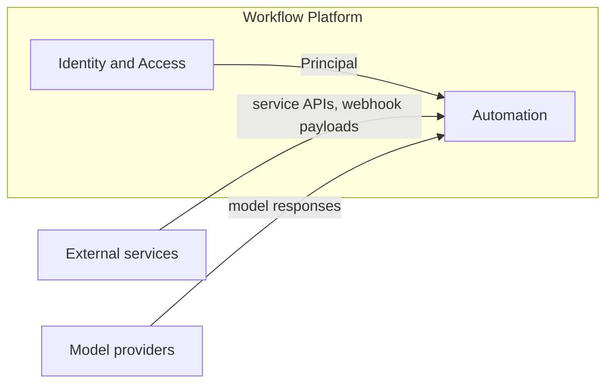
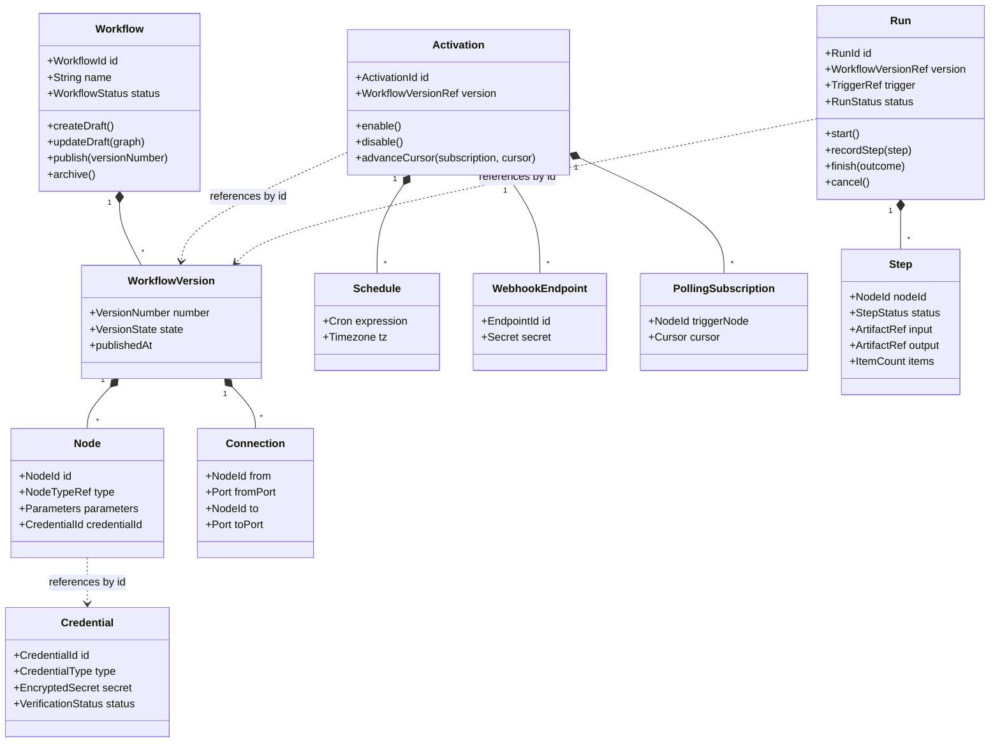
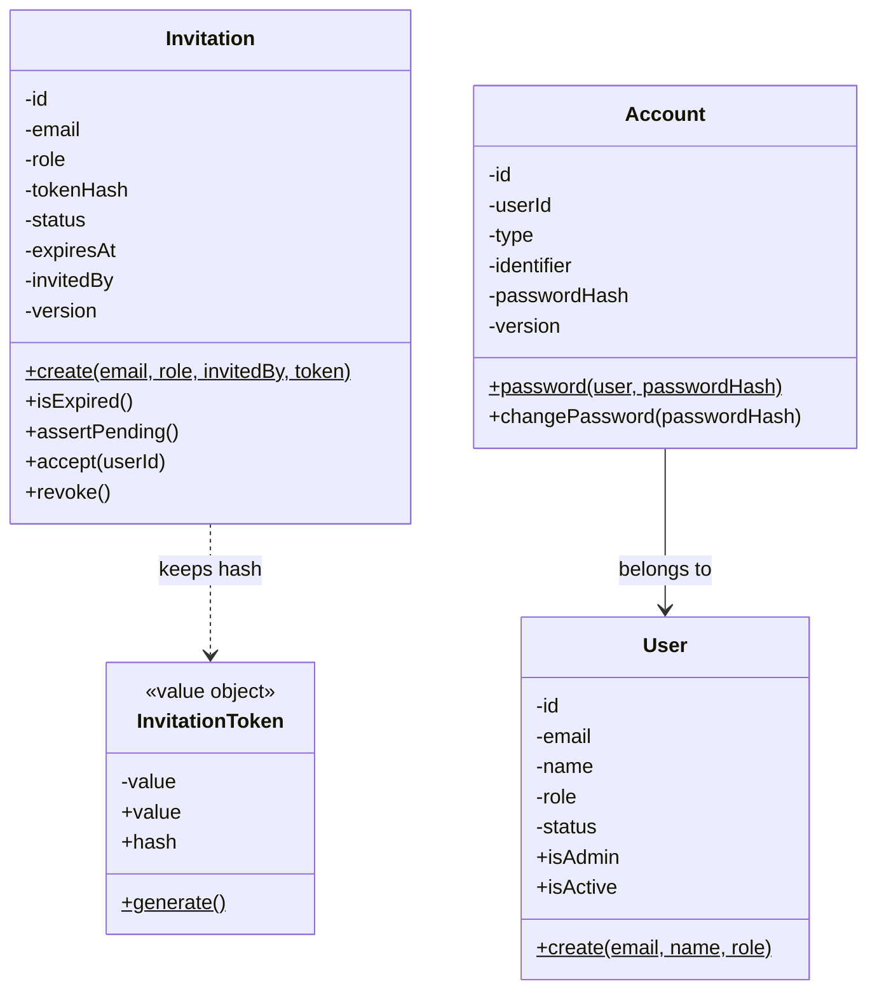

# Domain

## Bounded contexts

| Context           | Model                                                      | Data                                                             |
| ----------------- | ---------------------------------------------------------- | ---------------------------------------------------------------- |
| Identity & Access | User, Account, Session, Role; Invitation aggregate         | Tables `user`, `account`, `session`, `email_token`, `invitation` |
| Automation        | Workflow, Credential, Activation, Run; node type catalogue | Application tables; node types in code                           |

Automation covers the whole lifecycle: workflow → published version → activation → run → retention.

## Context map

Arrows point from upstream to downstream. Each upstream model is translated at the boundary of
Automation; no upstream model is used inside it.

| Upstream          | Downstream | Relationship          | What crosses the boundary                                                          |
| ----------------- | ---------- | --------------------- | ---------------------------------------------------------------------------------- |
| Identity & Access | Automation | Customer–Supplier     | Principal (user id, role), passed into every use case                              |
| External services | Automation | Anti-Corruption Layer | Node executors translate service APIs and webhook payloads into node items         |
| Model providers   | Automation | Anti-Corruption Layer | `ModelProviderGateway` translates provider responses into schema-validated outputs |

## Aggregates

| Aggregate  | Contents                                                | Invariants                                                                                                                                            |
| ---------- | ------------------------------------------------------- | ----------------------------------------------------------------------------------------------------------------------------------------------------- |
| Workflow   | WorkflowVersion (draft, published), Node, Connection    | Graph is acyclic and connected to a trigger node; node parameters satisfy the node type manifest; a published version is immutable                    |
| Credential | type, encrypted secret, verification status             | Secret is stored encrypted; only verified credentials are referenced by published versions                                                            |
| Activation | Schedule, WebhookEndpoint, PollingSubscription (cursor) | Belongs to exactly one published version; at most one activation per version                                                                          |
| Run        | Step (per node), trigger reference, status, timestamps  | State machine `queued → running → waiting → succeeded`, terminal alternatives `failed`, `cancelled`; a step belongs to a node of the executed version |

Node type is a catalogue entry in code, referenced as `nodeTypeId@version`; it is not an aggregate.

### Identity & Access

| Aggregate  | Contents                                                                                                                      | Invariants                                                                                                                                                                                                                                    |
| ---------- | ----------------------------------------------------------------------------------------------------------------------------- | --------------------------------------------------------------------------------------------------------------------------------------------------------------------------------------------------------------------------------------------- |
| Invitation | email, role, `tokenHash` (fingerprint of the link token), status (`pending`, `accepted`, `revoked`), expiry, inviter, version | Single use; accepted only while pending and before expiry (exclusive); rule violations throw domain errors; the link token itself is never stored; at most one pending invitation per email; the repository locks optimistically by `version` |
| Account    | user, type (`password`, `oidc`), identifier (the email for a password; issuer and subject for SSO), password hash, version    | One account per type and identifier; at most one password account per user; only a password account changes its password; the repository locks optimistically by `version`                                                                    |

Sessions and recovery tokens are records of `@nestjs/authentication` stored by the API. Email format, role membership and the password length are validated at the HTTP boundary; `User` (id, email, name, role, status `active` or `suspended`, `isAdmin`, `isActive`) is the person and the signed-in user as the use cases see it; it knows nothing about signing in. `Account` is a way to sign in that belongs to a user: a password today, an SSO identity later. The password hash lives on the account, so changing or resetting a password is the account's job; the seeded administrator has no account until recovery creates one. `InvitationToken` is the value object for the link token: it generates the value, is rebuilt from an incoming link and derives the fingerprint the invitation keeps.

## Domain events

| Event                      | Raised by | Effect                                         |
| -------------------------- | --------- | ---------------------------------------------- |
| WorkflowVersionPublished   | Workflow  | Activation is created for the version          |
| WorkflowVersionUnpublished | Workflow  | Activation is removed                          |
| RunFinished                | Run       | Run status projection and retention accounting |

## Class diagram

