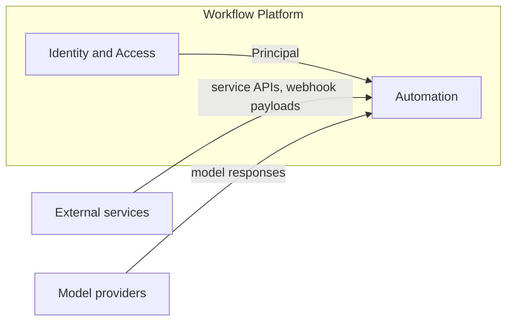
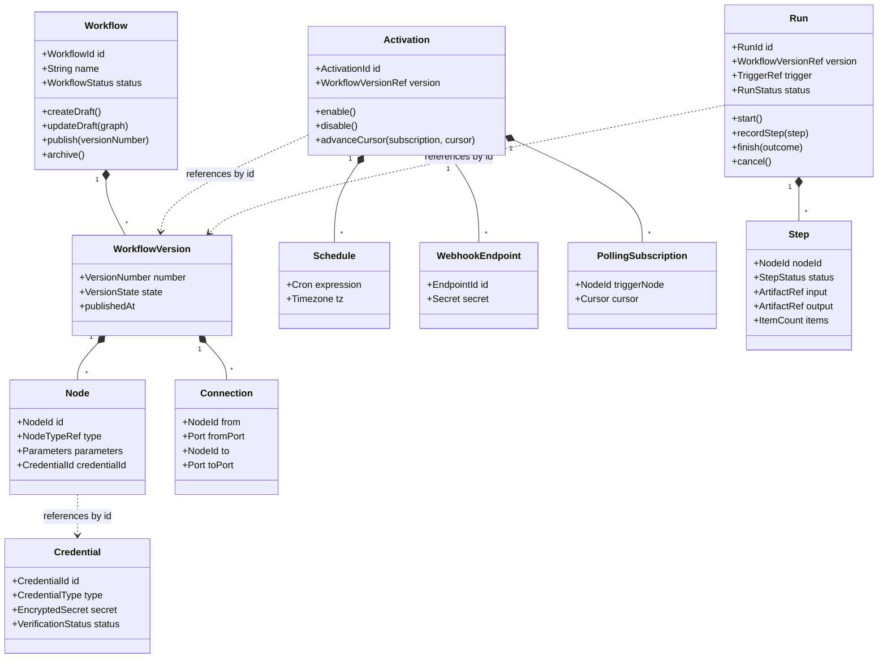

# Domain

## Bounded contexts

| Context           | Model                                                      | Data                                                              |
| ----------------- | ---------------------------------------------------------- | ----------------------------------------------------------------- |
| Identity & Access | User, Session, Role                                        | Better Auth tables (`user`, `session`, `account`, `verification`) |
| Automation        | Workflow, Credential, Activation, Run; node type catalogue | Application tables; node types in code                            |

Automation covers the whole lifecycle: workflow → published version → activation → run → retention.

## Context map

Arrows point from upstream to downstream. Each upstream model is translated at the boundary of
Automation; no upstream model is used inside it.

| Upstream          | Downstream | Relationship          | What crosses the boundary                                                          |
| ----------------- | ---------- | --------------------- | ---------------------------------------------------------------------------------- |
| Identity & Access | Automation | Customer–Supplier     | Principal (user id, role), passed into every use case                              |
| External services | Automation | Anti-Corruption Layer | Node executors translate service APIs and webhook payloads into node items         |
| Model providers   | Automation | Anti-Corruption Layer | `ModelProviderGateway` translates provider responses into schema-validated outputs |

## Aggregates

| Aggregate  | Contents                                                | Invariants                                                                                                                                            |
| ---------- | ------------------------------------------------------- | ----------------------------------------------------------------------------------------------------------------------------------------------------- |
| Workflow   | WorkflowVersion (draft, published), Node, Connection    | Graph is acyclic and connected to a trigger node; node parameters satisfy the node type manifest; a published version is immutable                    |
| Credential | type, encrypted secret, verification status             | Secret is stored encrypted; only verified credentials are referenced by published versions                                                            |
| Activation | Schedule, WebhookEndpoint, PollingSubscription (cursor) | Belongs to exactly one published version; at most one activation per version                                                                          |
| Run        | Step (per node), trigger reference, status, timestamps  | State machine `queued → running → waiting → succeeded`, terminal alternatives `failed`, `cancelled`; a step belongs to a node of the executed version |

Node type is a catalogue entry in code, referenced as `nodeTypeId@version`; it is not an aggregate.

## Domain events

| Event                      | Raised by | Effect                                         |
| -------------------------- | --------- | ---------------------------------------------- |
| WorkflowVersionPublished   | Workflow  | Activation is created for the version          |
| WorkflowVersionUnpublished | Workflow  | Activation is removed                          |
| RunFinished                | Run       | Run status projection and retention accounting |

## Class diagram

