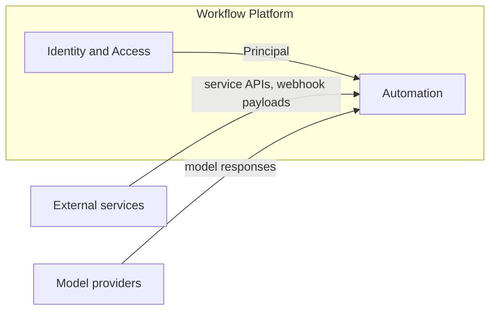
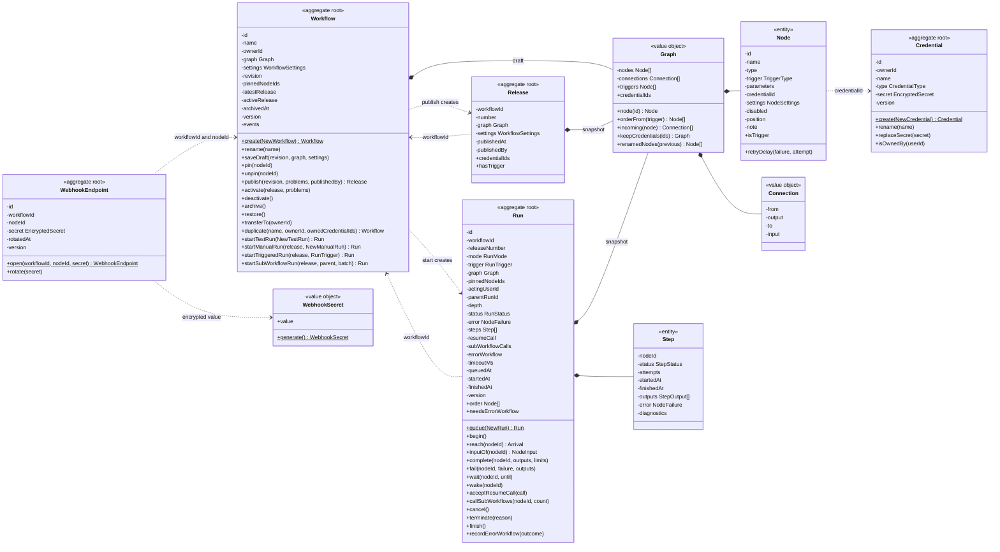
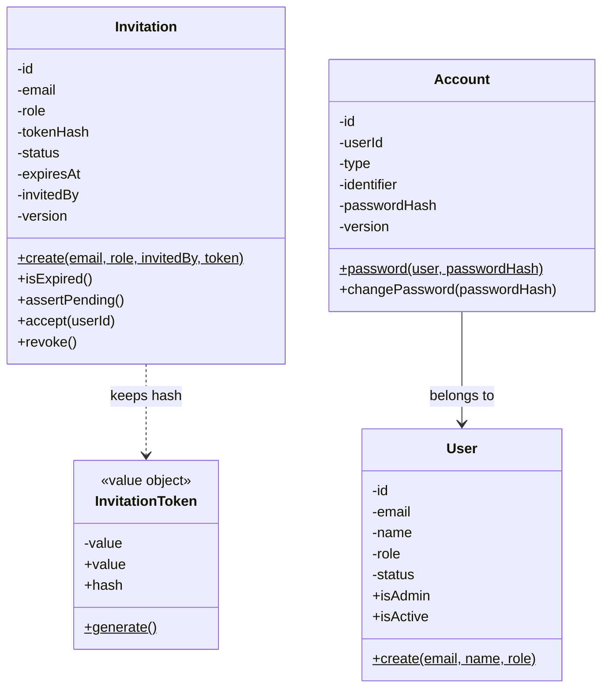

# Domain

## Bounded contexts

| Context           | Model                                               | Data                                                             |
| ----------------- | --------------------------------------------------- | ---------------------------------------------------------------- |
| Identity & Access | User, Account, Session, Role; Invitation aggregate  | Tables `user`, `account`, `session`, `email_token`, `invitation` |
| Automation        | Workflow, Release, Run, Credential, WebhookEndpoint | Application tables; node types in code                           |

Automation covers the whole lifecycle: workflow → release → activation → run → retention.

## Context map

Arrows point from upstream to downstream. Each upstream model is translated at the boundary of
Automation; no upstream model is used inside it.

| Upstream          | Downstream | Relationship          | What crosses the boundary                                                          |
| ----------------- | ---------- | --------------------- | ---------------------------------------------------------------------------------- |
| Identity & Access | Automation | Customer–Supplier     | Principal (user id, role), passed into every use case                              |
| External services | Automation | Anti-Corruption Layer | Node executors translate service APIs and webhook payloads into node items         |
| Model providers   | Automation | Anti-Corruption Layer | `ModelProviderGateway` translates provider responses into schema-validated outputs |

## Aggregates

### Automation

| Aggregate       | Contents                                                                                                    | Invariants                                                                                                                                                                                                                                                                                                                   |
| --------------- | ----------------------------------------------------------------------------------------------------------- | ---------------------------------------------------------------------------------------------------------------------------------------------------------------------------------------------------------------------------------------------------------------------------------------------------------------------------- |
| Workflow        | Draft (Graph of Nodes and Connections, settings, revision), pinned nodes, latest and active release numbers | A save names the current revision; the graph has unique node identifiers and names, connections between its nodes and no cycle; publishing, test runs and activation are refused while nodes have configuration problems; at most one active release, which has a trigger; an archived workflow is neither run nor activated |
| Release         | An immutable copy of the draft's graph and settings, numbered 1, 2, 3…                                      | Created only by publishing; never changes; production runs execute it                                                                                                                                                                                                                                                        |
| Run             | Graph snapshot, Steps (one per node), trigger, acting user, status, timestamps                              | State machine `queued → running → waiting → succeeded`, terminal alternatives `failed`, `cancelled`; nodes in dependency order from the firing trigger; a finished node never runs again; on-error settings; 256 MB per run; one accepted resume call; sub-workflow depth and call limits                                    |
| Credential      | Type, encrypted secret, owner                                                                               | The secret is stored encrypted and never returned; it opens only for runs whose acting user owns it                                                                                                                                                                                                                          |
| WebhookEndpoint | Public identifier, encrypted secret, workflow and node                                                      | One address per webhook node, stable across drafts, releases and activations; its secret rotates                                                                                                                                                                                                                             |

A connection carries items without a type. The contract belongs to the node that receives the items: its
node type's parameter definitions and the user's bindings. The node executor checks it for each item when
the node runs. Node types are catalogue entries in code (interface adapters), referenced as
`nodeTypeId@version`. They are not aggregates, and they report the configuration problems of their nodes.
Editor hints, such as unreachable nodes or unknown fields, are computed by clients. The full model,
including the owner of every rule, is in `specs/002-workflow-builder/data-model.md`.

### Identity & Access

| Aggregate  | Contents                                                                                                                      | Invariants                                                                                                                                                                                                                                    |
| ---------- | ----------------------------------------------------------------------------------------------------------------------------- | --------------------------------------------------------------------------------------------------------------------------------------------------------------------------------------------------------------------------------------------- |
| Invitation | email, role, `tokenHash` (fingerprint of the link token), status (`pending`, `accepted`, `revoked`), expiry, inviter, version | Single use; accepted only while pending and before expiry (exclusive); rule violations throw domain errors; the link token itself is never stored; at most one pending invitation per email; the repository locks optimistically by `version` |
| Account    | user, type (`password`, `oidc`), identifier (the email for a password; issuer and subject for SSO), password hash, version    | One account per type and identifier; at most one password account per user; only a password account changes its password; the repository locks optimistically by `version`                                                                    |

Sessions and recovery tokens are records of `@nestjs/authentication` stored by the API. Email format, role membership and the password length are validated at the HTTP boundary; `User` (id, email, name, role, status `active` or `suspended`, `isAdmin`, `isActive`) is the person and the signed-in user as the use cases see it; it knows nothing about signing in. `Account` is a way to sign in that belongs to a user: a password today, an SSO identity later. The password hash lives on the account, so changing or resetting a password is the account's job; the seeded administrator has no account until recovery creates one. `InvitationToken` is the value object for the link token: it generates the value, is rebuilt from an incoming link and derives the fingerprint the invitation keeps.

## Domain events

| Event             | Raised by | Effect                                                                                     |
| ----------------- | --------- | ------------------------------------------------------------------------------------------ |
| ActivationChanged | Workflow  | Through the outbox, the engine schedules converge to the workflow's current active release |

Domain events are used only for effects that leave the database transaction. Every other reaction is an
explicit flow in a use case.

## Class diagram

