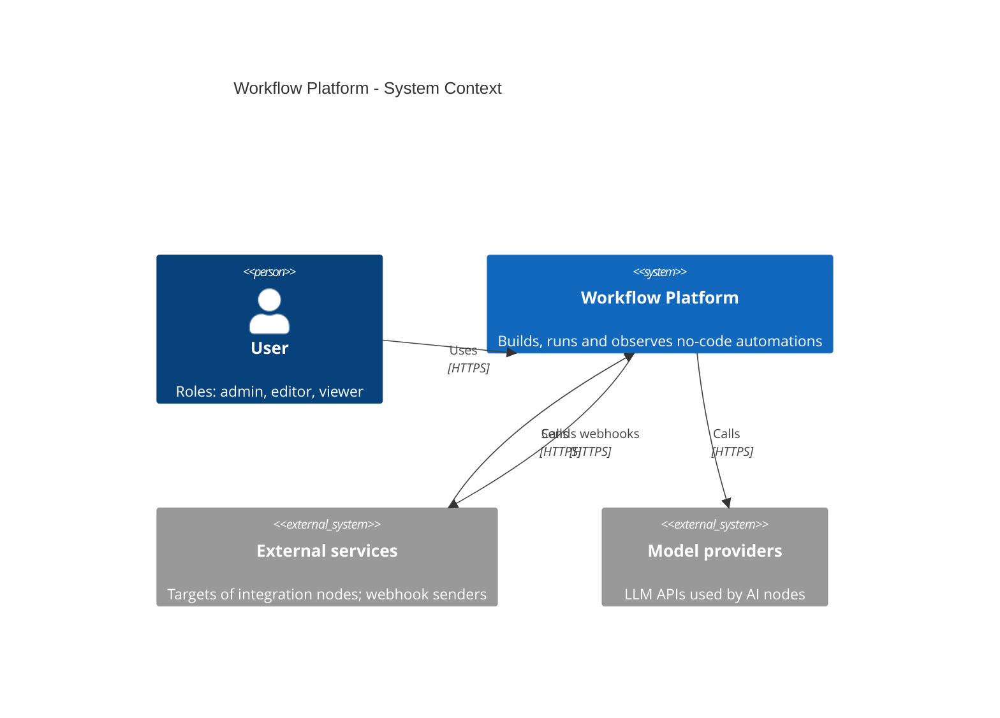
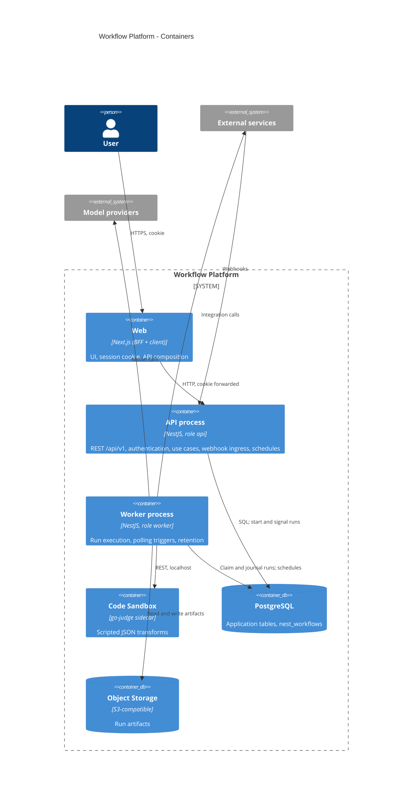

# System

## System context

## Containers

## Process roles

One codebase, one image, one `AppModule`. The `ROLE` variable selects the bootstrap and the module options.

| Role     | Bootstrap                                                  | WorkflowsModule        | Responsibility                                                        |
| -------- | ---------------------------------------------------------- | ---------------------- | --------------------------------------------------------------------- |
| `api`    | `NestFactory.create(AppModule)`, HTTP listener             | `worker: false`        | Starts, signals and inspects runs; manages schedules; serves HTTP     |
| `worker` | `NestFactory.createApplicationContext(AppModule)`, no HTTP | `worker.enabled: true` | Claims and executes run instances; polling trigger job; retention job |

Workflow classes and the PostgreSQL workflow store are registered in both roles. Both roles enable shutdown hooks; `shutdownTimeout` is below the platform grace period.

## Deployment

| Aspect         | Value                                                                                   |
| -------------- | --------------------------------------------------------------------------------------- |
| Image          | One image for both roles; command differs by `ROLE`                                     |
| API scaling    | HPA on CPU and request rate                                                             |
| Worker scaling | KEDA PostgreSQL scaler on due instances in `nest_workflows.instances`                   |
| Worker pod     | Worker container plus go-judge sidecar on `localhost:5050`                              |
| State          | PostgreSQL and Object Storage only; processes are stateless                             |
| Migrations     | `drizzle-kit migrate` and `nest-workflows migrate` run as a release step before rollout |
| Configuration  | Environment variables validated at startup                                              |
