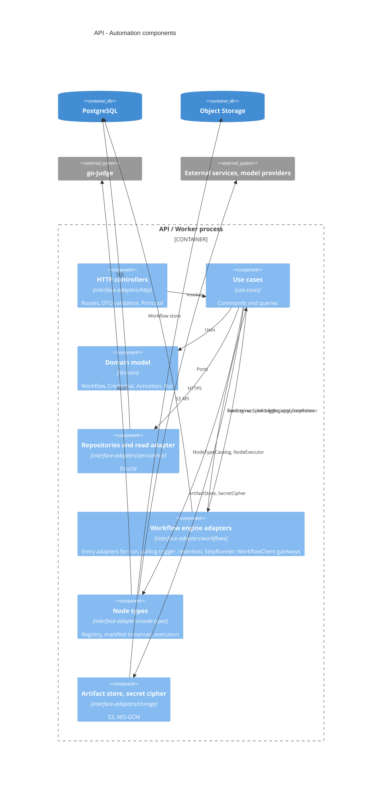
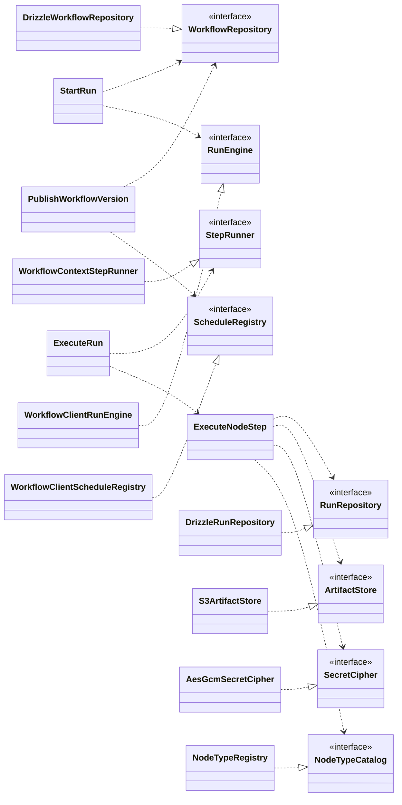

# API

## Layers

```text
apps/api/src/
  domain/              entities, value objects, aggregates, NodeType model, domain events,
                       repository interfaces
  use-cases/           one interactor per command or query; output ports
  interface-adapters/  entry adapters (framework → use case) and gateways (port → technology)
  frameworks/          main.ts, app.module.ts, modules, config, database, auth, workflows, telemetry
```

Dependencies point inward. Layers are flat; context membership is expressed by the module that assembles the providers.

| `interface-adapters/` | Entry adapters                                                                                                    | Gateways                                                                                                                                                                         |
| --------------------- | ----------------------------------------------------------------------------------------------------------------- | -------------------------------------------------------------------------------------------------------------------------------------------------------------------------------- |
| `http/`               | Controllers: HTTP request → use case; DTOs; auth guard with Principal mapping                                     | —                                                                                                                                                                                |
| `persistence/`        | —                                                                                                                 | Repositories and read adapter over Drizzle; schema and migrations                                                                                                                |
| `workflows/`          | `@Workflow` classes `run`, `polling-trigger`, `retention`: engine → use case; `StepRunner` over `WorkflowContext` | `RunEngine`, `ScheduleRegistry` over `WorkflowClient`                                                                                                                            |
| `node-types/<type>/`  | —                                                                                                                 | Per type: `manifest.ts` (a `NodeType` instance) and `executor.ts` (`NodeExecutor` → external service, sandbox or model provider); one `registry.ts` implements `NodeTypeCatalog` |
| `storage/`            | —                                                                                                                 | `ArtifactStore` over S3; `SecretCipher` over `node:crypto`                                                                                                                       |

## Modules

| Module                 | Providers                                                                                                                                         |
| ---------------------- | ------------------------------------------------------------------------------------------------------------------------------------------------- |
| `IdentityAccessModule` | Better Auth instance (Drizzle adapter, admin plugin with access control), global AuthGuard, Principal mapping                                     |
| `AutomationModule`     | Use cases, repositories, read adapter, artifact store, secret cipher, node type registry and executors, workflow classes, WorkflowClient gateways |

Modules are dependency-injection assemblies. The provider set is identical in both process roles. The HTTP interface under `/api/v1` is described by the OpenAPI document generated by the API.

## Use cases

| Area       | Commands                                                      | Queries                    |
| ---------- | ------------------------------------------------------------- | -------------------------- |
| Workflow   | create, update draft, publish version, archive                | get, list, validate draft  |
| Credential | create, update, delete                                        | list                       |
| Activation | enable, disable                                               | —                          |
| Run        | start, cancel                                                 | get, list, get step output |
| Execution  | execute run, execute node step, poll trigger, apply retention | —                          |
| Settings   | update retention policy                                       | get retention policy       |

Every use case receives a Principal and returns a `Result`.

## Ports and adapters

| Port                                                                          | Adapter                                                                  | Technology                                    |
| ----------------------------------------------------------------------------- | ------------------------------------------------------------------------ | --------------------------------------------- |
| WorkflowRepository, CredentialRepository, ActivationRepository, RunRepository | Drizzle repositories                                                     | PostgreSQL                                    |
| RunHistoryReader                                                              | Drizzle read adapter                                                     | PostgreSQL                                    |
| ArtifactStore                                                                 | S3 artifact store                                                        | S3-compatible storage                         |
| SecretCipher                                                                  | AES-GCM cipher                                                           | `node:crypto`, versioned key from environment |
| NodeTypeCatalog                                                               | Registry built from DI: manifests and executor lookup                    | In process                                    |
| NodeExecutor                                                                  | One executor per node type                                               | HTTPS, sandbox, provider SDK                  |
| StepRunner                                                                    | `WorkflowContext` adapter: durable steps, idempotency key, sleep, signal | `@nestjs/workflows`                           |
| RunEngine, ScheduleRegistry                                                   | WorkflowClient gateways                                                  | `@nestjs/workflows`                           |
| CodeSandboxGateway                                                            | go-judge REST client                                                     | HTTP, localhost                               |
| ModelProviderGateway                                                          | Provider SDK client                                                      | HTTPS                                         |

Transactions are propagated with `nestjs-cls` and `@nestjs-cls/transactional` (Drizzle adapter); `RunEngine.start` joins the current transaction. Domain events are dispatched with `@nestjs/event-emitter`; handlers run before commit.

## Components





## Packages

`@nestjs/workflows`, `@nestjs/drizzle`, `nestjs-cls` with `@nestjs-cls/transactional`, `@nestjs/event-emitter`, `@nestjs/config`, `@nestjs/terminus`, `@nestjs/swagger`, `nestjs-pino`, OpenTelemetry SDK, Better Auth with `@thallesp/nestjs-better-auth`, AWS SDK for S3.
