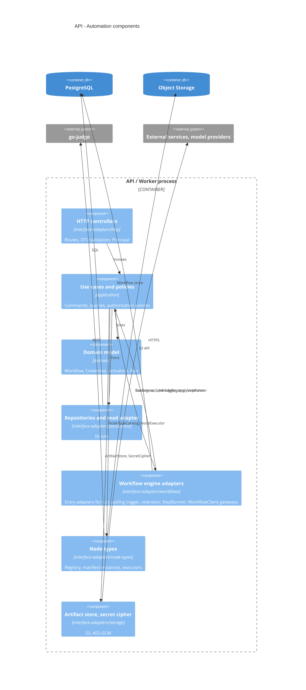
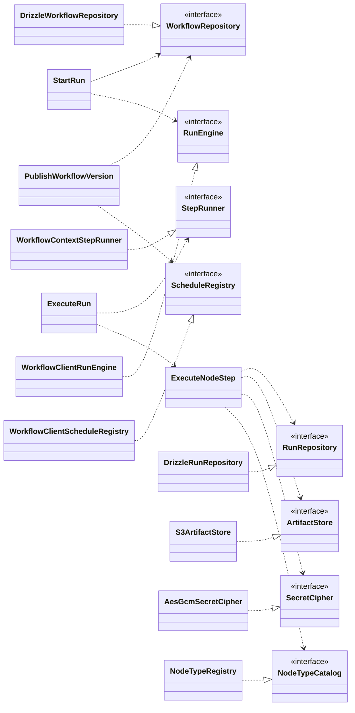

# API

## Layers

```text
apps/api/src/
  main.ts              composition root and bootstrap (Nest application, trust proxy, CSRF protection, Swagger)
  instrumentation.ts   OpenTelemetry Node SDK, preloaded with --import
  domain/              entities (Invitation, User), domain errors; interfaces.ts with the entity props and types
  application/         use-cases/ (one interactor per command or query), policies/ (authorization policies); interfaces.ts with input/output models and output ports
  interface-adapters/  http/ (controllers, presenters, request/response models, filters), auth/ (framework extension points and stores), mailing/ (gateway, outbox transport, handler, templates), persistence/ (repositories with data mappers, queries, schema); interfaces.ts with what frameworks provide
  frameworks/          di/ (Nest modules: dependency assembly only) and one folder per technology with its factory function (drizzle, pino)
```

Dependencies point inward. Layers are flat; context membership is expressed by the module that assembles the providers. `domain` and `application` import no framework except the `@Policy()` marker of `@nestjs/authorization`; use cases are plain classes assembled by factory providers in `frameworks/di`. Clients (Drizzle, SMTP transport, outbox store) are created only in `frameworks`. Abstractions that cross a layer boundary are abstract classes, which also serve as injection tokens.

| `interface-adapters/` | Entry adapters                                                                                                                                                                                                                 | Presenters and gateways                                                                                                                                                                                                                      |
| --------------------- | ------------------------------------------------------------------------------------------------------------------------------------------------------------------------------------------------------------------------------ | -------------------------------------------------------------------------------------------------------------------------------------------------------------------------------------------------------------------------------------------- |
| `http/`               | Controllers (one transaction per command), request models with validation, `DomainErrorFilter` (domain errors → Nest `HttpException`), security headers middleware                                                             | `InvitationPresenter`, `UserPresenter` (entity or read-model row → response model)                                                                                                                                                           |
| `auth/`               | `SessionAuthenticationProvider` (`@nestjs/authentication` cookie-session provider: `validate` → `UserRepository.findActiveById`), `PasswordRecoveryHandler` (reset handler: `findActiveByEmail`, outbox mail, `ResetPassword`) | `stores/` (`DrizzleSessionStore`, `DrizzleEmailTokenStore`: the store contracts of `@nestjs/authentication` over the Drizzle schema)                                                                                                         |
| `mailing/`            | `MailOutboxHandler`: one `@OnOutboxMessage('mail')` handler that rebuilds the stored message with `Mailer.render` and sends it through `SmtpTransport`; permanent `MailError` → dead letter                                    | `MailGateway` (port `Mailing` → `Mailer.send(MailClass)`), `OutboxMailTransport` (the `Mailer` transport: writes the rendered message to the transactional outbox), `templates/` with the mail classes `InvitationMail`, `PasswordResetMail` |
| `persistence/`        | —                                                                                                                                                                                                                              | `repositories/` (`DrizzleUserRepository`, `DrizzleInvitationRepository`), `mappers/` (`UserMapper`, `InvitationMapper`), `queries/` (`DrizzleInvitationQueries`: read models, SQL filtering), `schema/` and migrations                       |
| `workflows/`          | `@Workflow` classes `run`, `polling-trigger`, `retention`: engine → use case; `StepRunner` over `WorkflowContext`                                                                                                              | `RunEngine`, `ScheduleRegistry` over `WorkflowClient`                                                                                                                                                                                        |
| `node-types/<type>/`  | —                                                                                                                                                                                                                              | Per type: `manifest.ts` (a `NodeType` instance) and `executor.ts` (`NodeExecutor` → external service, sandbox or model provider); one `registry.ts` implements `NodeTypeCatalog`                                                             |
| `storage/`            | —                                                                                                                                                                                                                              | `ArtifactStore` over S3; `SecretCipher` over `node:crypto`                                                                                                                                                                                   |

## Modules

| Module                                                                          | Providers                                                                                                                                                                                                                                                                      |
| ------------------------------------------------------------------------------- | ------------------------------------------------------------------------------------------------------------------------------------------------------------------------------------------------------------------------------------------------------------------------------ |
| `AppModule`                                                                     | Health controller, `APP_PIPE` (`ValidationPipe`), `APP_FILTER` (`DomainErrorFilter`), security headers middleware, `TerminusModule` (graceful shutdown); imports the infrastructure modules and the context modules                                                            |
| `IdentityAccessModule`                                                          | Bounded context Identity & Access: `AuthenticationModule` (sessions, password reset, scrypt hasher), `AuthorizationModule` (policies); `AuthController`, `InvitationsController`; repositories, stores, session provider, recovery handler, use cases (factory providers)      |
| `ConfigModule`, `LoggingModule`, `DatabaseModule`, `OutboxModule`, `MailModule` | Infrastructure assembly: validated environment, pino, `pg.Pool` + Drizzle (`Database`) with transaction propagation, outbox store, `@nestjs/mail` with `OutboxMailTransport` as its transport, `SmtpTransport`, mail classes, `MailGateway` (`Mailing`) and the outbox handler |
| `AutomationModule`                                                              | Use cases, repositories, read adapter, artifact store, secret cipher, node type registry and executors, workflow classes, WorkflowClient gateways                                                                                                                              |

Modules are dependency-injection assemblies. The provider set is identical in both process roles. The HTTP interface under `/api/v1` is described by the OpenAPI document generated by the API.

## Use cases

| Area       | Commands                                                      | Queries                    |
| ---------- | ------------------------------------------------------------- | -------------------------- |
| Session    | authenticate user, change password, reset password            | —                          |
| Invitation | create, revoke, accept                                        | list pending, verify link  |
| Workflow   | create, update draft, publish version, archive                | get, list, validate draft  |
| Credential | create, update, delete                                        | list                       |
| Activation | enable, disable                                               | —                          |
| Run        | start, cancel                                                 | get, list, get step output |
| Execution  | execute run, execute node step, poll trigger, apply retention | —                          |
| Settings   | update retention policy                                       | get retention policy       |

Command use cases load aggregates through repositories; query use cases read raw rows through query abstractions (filtering and ordering in SQL) that presenters turn into responses. Rule violations are domain errors that the HTTP filter translates. Session issue, rotation and revocation, recovery tokens and password hashing come from `@nestjs/authentication`; the first administrator is seeded by a database migration and sets the first password through recovery.

## Ports and adapters

| Port                                                                          | Adapter                                                                                                                                                                                                                       | Technology                                    |
| ----------------------------------------------------------------------------- | ----------------------------------------------------------------------------------------------------------------------------------------------------------------------------------------------------------------------------- | --------------------------------------------- |
| InvitationRepository, InvitationQueries                                       | `DrizzleInvitationRepository` (commands, through `TransactionHost.tx`; `update` checks the stored `version`; not-found and conflicts thrown as domain errors); `DrizzleInvitationQueries` (read model rows, filtering in SQL) | PostgreSQL                                    |
| UserRepository, PasswordHasher                                                | `DrizzleUserRepository`; the scrypt `PasswordHasher` of `@nestjs/authentication` bound to the port                                                                                                                            | PostgreSQL, Node crypto                       |
| Mailing                                                                       | `MailGateway` → `@nestjs/mail` `Mailer` → `OutboxMailTransport` (outbox row in the current transaction) → relay → `MailOutboxHandler` → `SmtpTransport`; `InvitationMail` builds the link from `WEB_BASE_URL` and the token   | PostgreSQL (`nest_outbox`), SMTP              |
| WorkflowRepository, CredentialRepository, ActivationRepository, RunRepository | Drizzle repositories                                                                                                                                                                                                          | PostgreSQL                                    |
| RunHistoryReader                                                              | Drizzle read adapter                                                                                                                                                                                                          | PostgreSQL                                    |
| ArtifactStore                                                                 | S3 artifact store                                                                                                                                                                                                             | S3-compatible storage                         |
| SecretCipher                                                                  | AES-GCM cipher                                                                                                                                                                                                                | `node:crypto`, versioned key from environment |
| NodeTypeCatalog                                                               | Registry built from DI: manifests and executor lookup                                                                                                                                                                         | In process                                    |
| NodeExecutor                                                                  | One executor per node type                                                                                                                                                                                                    | HTTPS, sandbox, provider SDK                  |
| StepRunner                                                                    | `WorkflowContext` adapter: durable steps, idempotency key, sleep, signal                                                                                                                                                      | `@nestjs/workflows`                           |
| RunEngine, ScheduleRegistry                                                   | WorkflowClient gateways                                                                                                                                                                                                       | `@nestjs/workflows`                           |
| CodeSandboxGateway                                                            | go-judge REST client                                                                                                                                                                                                          | HTTP, localhost                               |
| ModelProviderGateway                                                          | Provider SDK client                                                                                                                                                                                                           | HTTPS                                         |

Transactions are propagated with `nestjs-cls` and `@nestjs-cls/transactional` (Drizzle adapter): command entry points carry `@Transactional()`, repositories write through `TransactionHost.tx`; `RunEngine.start` joins the current transaction. Effects that leave the process (email) are rendered by `@nestjs/mail` and written to the `@nestjs/outbox` store in the same transaction by `OutboxMailTransport`; the relay delivers them through `MailOutboxHandler` (`mailing/`) with retries and a dead-letter table. Domain events are dispatched with `@nestjs/event-emitter`; handlers run before commit.

## Components





## Packages

`@nestjs/workflows`, `nestjs-cls` with `@nestjs-cls/transactional` (Drizzle adapter), `@nestjs/outbox`, `@nestjs/mail`, `@nestjs/event-emitter`, `@nestjs/config`, `@nestjs/authentication`, `@nestjs/authorization`, `@nestjs/terminus`, `@nestjs/swagger`, `nestjs-pino`, OpenTelemetry Node SDK with auto-instrumentations (preloaded with `--import`, configured through `OTEL_*`), Drizzle ORM with `pg`, AWS SDK for S3.
