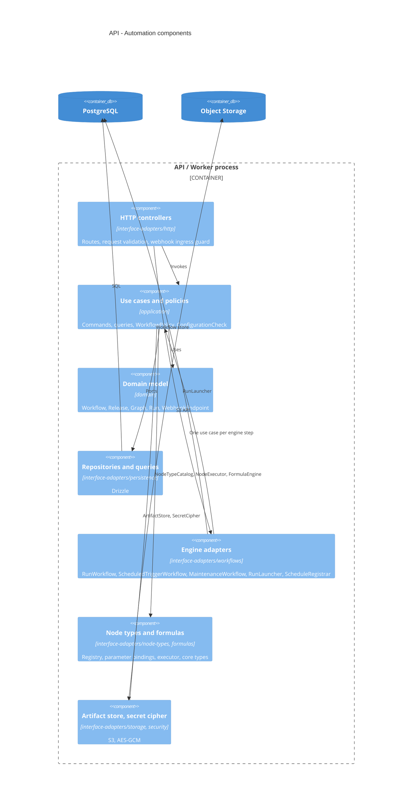
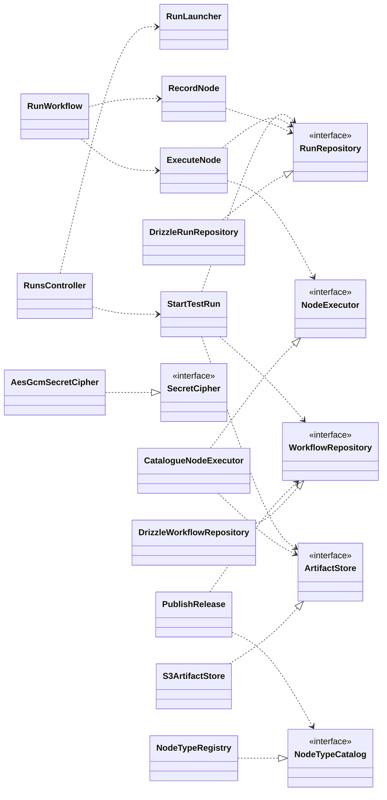

# API

## Layers

```text
apps/api/src/
  main.ts              composition root and bootstrap (Nest application, trust proxy, CSRF protection, Swagger)
  instrumentation.ts   OpenTelemetry Node SDK, preloaded with --import
  domain/              entities (Invitation, User, Workflow, Release, Graph, Node, Connection, Run, Step, WebhookEndpoint), domain errors; interfaces.ts with the entity props and types
  application/         use-cases/ (one interactor per command or query), policies/ (authorization policies), services/ (ConfigurationCheck, WebhookEndpointIssuer); interfaces.ts with input/output models and output ports
  interface-adapters/  http/ (controllers, presenters, request/response models, guards, filters, validators), auth/ (framework extension points and stores), mailing/ (gateway, outbox transport, handler, templates), persistence/ (repositories with data mappers, queries, schema, stores), formulas/ (the formula language), node-types/ (catalogue, parameter bindings, executor, core node types), storage/ (step output in S3), security/ (secret cipher), workflows/ (engine workflows, launcher, schedule registrar); interfaces.ts with what frameworks provide
  frameworks/          di/ (Nest modules: dependency assembly only) and one folder per technology with its factory function (drizzle, pino, s3)
```

Dependencies point inward. Layers are flat; context membership is expressed by the module that assembles the providers. `domain` and `application` import no framework except the `@Policy()` marker of `@nestjs/authorization`; use cases are plain classes assembled by factory providers in `frameworks/di`. Clients (Drizzle, SMTP transport, outbox store) are created only in `frameworks`. Abstractions that cross a layer boundary are abstract classes, which also serve as injection tokens.

| `interface-adapters/` | Entry adapters                                                                                                                                                                                                                                                                                                                                                                    | Presenters and gateways                                                                                                                                                                                                                                                                                               |
| --------------------- | --------------------------------------------------------------------------------------------------------------------------------------------------------------------------------------------------------------------------------------------------------------------------------------------------------------------------------------------------------------------------------- | --------------------------------------------------------------------------------------------------------------------------------------------------------------------------------------------------------------------------------------------------------------------------------------------------------------------- |
| `http/`               | Controllers (one transaction per command), request models with validation (JSON depth and size validators), `DomainErrorFilter` (domain errors → Nest `HttpException`; `InvalidGraphError` and `NodeConfigurationError` answer 422 with `faults` or `problems`), `WebhookIngressGuard` and `WebhookErrorFilter` (the uniform 404 of webhook ingress), security headers middleware | Presenters (entity or read model → response model): `InvitationPresenter`, `UserPresenter`, `WorkflowPresenter`, `GraphPresenter`, `ReleasePresenter`, `RunPresenter`, `NodeTypePresenter`, `WebhookEndpointPresenter`; `DraftMapper` (request graph → `DraftGraph`)                                                  |
| `auth/`               | `SessionAuthenticationProvider` (`@nestjs/authentication` cookie-session provider: `validate` → `UserRepository.findActiveById`), `PasswordRecoveryHandler` (reset handler: `findActiveByEmail`, outbox mail, `ResetPassword`)                                                                                                                                                    | `stores/` (`DrizzleSessionStore`, `DrizzleEmailTokenStore`: the store contracts of `@nestjs/authentication` over the Drizzle schema)                                                                                                                                                                                  |
| `mailing/`            | `MailOutboxHandler`: one `@OnOutboxMessage('mail')` handler that rebuilds the stored message with `Mailer.render` and sends it through `SmtpTransport`; permanent `MailError` → dead letter                                                                                                                                                                                       | `MailGateway` (port `Mailing` → `Mailer.send(MailClass)`), `OutboxMailTransport` (the `Mailer` transport: writes the rendered message to the transactional outbox), `templates/` with the mail classes `InvitationMail`, `PasswordResetMail`                                                                          |
| `persistence/`        | —                                                                                                                                                                                                                                                                                                                                                                                 | `repositories/` (Drizzle repositories of every aggregate; `update` checks the stored `version`; `DrizzleWorkflowRepository` writes `ActivationChanged` to the outbox), `mappers/`, `queries/` (read models, SQL filtering, keyset pages), `stores/` (`DrizzleIdempotencyStore`), `schema/` and migrations             |
| `workflows/`          | `@Workflow` classes: `RunWorkflow` (begin, then reach and execute-and-record per node, then finish), `ScheduledTriggerWorkflow`, `MaintenanceWorkflow` (every minute); `ActivationHandler` (`@OnOutboxMessage('automation.activation')`)                                                                                                                                          | `RunLauncher` (`WorkflowClient.start` in the caller's transaction, `cancel`), `ScheduleRegistrar` (`WorkflowSchedules`)                                                                                                                                                                                               |
| `node-types/`         | —                                                                                                                                                                                                                                                                                                                                                                                 | `NodeTypeRegistry` (implements `NodeTypeCatalog`), `NodeConfiguration` (configuration problems), `parameters/` (bindings: fixed value, field reference, formula), `CatalogueNodeExecutor` (implements `NodeExecutor`), `types/` (one class per core node type; its zod parameter schema is the node's input contract) |
| `formulas/`           | —                                                                                                                                                                                                                                                                                                                                                                                 | `Formula` (acorn parse of `{{ }}`), a safe interpreter with allow-listed methods and budgets, `FormulaScope` (n8n variables)                                                                                                                                                                                          |
| `storage/`            | —                                                                                                                                                                                                                                                                                                                                                                                 | `S3ArtifactStore`: step outputs as JSON Lines chunks (500 items or 4 MiB) under `runs/<run>/nodes/<node>/a<attempt>/<port>/`                                                                                                                                                                                          |
| `security/`           | —                                                                                                                                                                                                                                                                                                                                                                                 | `AesGcmSecretCipher` (port `SecretCipher`): AES-256-GCM with versioned keys from `SECRET_KEYS`                                                                                                                                                                                                                        |

## Modules

| Module                                                                          | Providers                                                                                                                                                                                                                                                                                                                                                                                                                  |
| ------------------------------------------------------------------------------- | -------------------------------------------------------------------------------------------------------------------------------------------------------------------------------------------------------------------------------------------------------------------------------------------------------------------------------------------------------------------------------------------------------------------------- |
| `AppModule`                                                                     | Health controller, `APP_PIPE` (`ValidationPipe`), `APP_FILTER` (`DomainErrorFilter`), security headers middleware, `TerminusModule` (graceful shutdown); imports the infrastructure modules and the context modules                                                                                                                                                                                                        |
| `IdentityAccessModule`                                                          | Bounded context Identity & Access: `AuthenticationModule` (sessions, password reset, scrypt hasher), `AuthorizationModule` (policies); `AuthController`, `InvitationsController`; repositories, stores, session provider, recovery handler, use cases (factory providers)                                                                                                                                                  |
| `ConfigModule`, `LoggingModule`, `DatabaseModule`, `OutboxModule`, `MailModule` | Infrastructure assembly: validated environment, pino, `pg.Pool` + Drizzle (`Database`) with transaction propagation, outbox store, `@nestjs/mail` with `OutboxMailTransport` as its transport, `SmtpTransport`, mail classes, `MailGateway` (`Mailing`) and the outbox handler                                                                                                                                             |
| `AutomationModule`                                                              | Bounded context Automation: controllers (workflows, releases, activation, runs, node types, webhook endpoints, webhook ingress), `WorkflowPolicy`, repositories, queries, `NodeTypeRegistry` with the core node types, `CatalogueNodeExecutor`, `S3ArtifactStore`, `AesGcmSecretCipher`, `DrizzleIdempotencyStore` with `IdempotencyModule`, engine workflows, launcher, schedule registrar, use cases (factory providers) |
| `WorkflowsModule`                                                               | `@nestjs/workflows` on `PostgresWorkflowStore` (schema `nest_workflows`); the worker runs only with `ROLE=worker`                                                                                                                                                                                                                                                                                                          |

Modules are dependency-injection assemblies. The provider set is identical in both process roles: `ROLE=api` serves HTTP and starts engine instances, `ROLE=worker` runs an application context whose engine worker claims and executes them. The HTTP interface under `/api/v1` is described by the OpenAPI document generated by the API.

## Use cases

| Area       | Commands                                                                                                              | Queries                                                                  |
| ---------- | --------------------------------------------------------------------------------------------------------------------- | ------------------------------------------------------------------------ |
| Session    | authenticate user, change password, reset password                                                                    | —                                                                        |
| Invitation | create, revoke, accept                                                                                                | list pending, verify link                                                |
| Workflow   | create, rename, save draft, pin sample, unpin sample, archive, restore, duplicate, transfer                           | get (with configuration problems), list, list node types                 |
| Release    | publish release, activate release, deactivate workflow                                                                | list releases, get release, list active schedules, list active workflows |
| Webhook    | rotate webhook secret, start webhook run                                                                              | list webhook endpoints, resolve webhook                                  |
| Run        | start test run, start manual run, start scheduled run, cancel run                                                     | get run, list runs, read step output, list stale runs                    |
| Execution  | begin run, reach node, execute node, record node, finish run, terminate run (execute and record share an engine step) | —                                                                        |
| Credential | create, update, delete (planned, feature D)                                                                           | list (planned)                                                           |
| Settings   | update retention policy (planned, feature F)                                                                          | get retention policy (planned)                                           |

Command use cases load aggregates through repositories; query use cases read raw rows through query abstractions (filtering and ordering in SQL) that presenters turn into responses. Rule violations are domain errors that the HTTP filter translates. Session issue, rotation and revocation, recovery tokens and password hashing come from `@nestjs/authentication`; the first administrator is seeded by a database migration and sets the first password through recovery.

## Ports and adapters

| Port                                                                                         | Adapter                                                                                                                                                                                                                       | Technology                                    |
| -------------------------------------------------------------------------------------------- | ----------------------------------------------------------------------------------------------------------------------------------------------------------------------------------------------------------------------------- | --------------------------------------------- |
| InvitationRepository, InvitationQueries                                                      | `DrizzleInvitationRepository` (commands, through `TransactionHost.tx`; `update` checks the stored `version`; not-found and conflicts thrown as domain errors); `DrizzleInvitationQueries` (read model rows, filtering in SQL) | PostgreSQL                                    |
| UserRepository, PasswordHasher                                                               | `DrizzleUserRepository`; the scrypt `PasswordHasher` of `@nestjs/authentication` bound to the port                                                                                                                            | PostgreSQL, Node crypto                       |
| Mailing                                                                                      | `MailGateway` → `@nestjs/mail` `Mailer` → `OutboxMailTransport` (outbox row in the current transaction) → relay → `MailOutboxHandler` → `SmtpTransport`; `InvitationMail` builds the link from `WEB_BASE_URL` and the token   | PostgreSQL (`nest_outbox`), SMTP              |
| WorkflowRepository, ReleaseRepository, RunRepository, WebhookEndpointRepository, NodeSamples | Drizzle repositories; `DrizzleRunRepository` writes only the steps that changed and reads a test run's graph from its snapshot, a production run's from its release                                                           | PostgreSQL                                    |
| WorkflowQueries, RunQueries                                                                  | Drizzle read models through `TransactionHost` (a command's response reads its own transaction)                                                                                                                                | PostgreSQL                                    |
| ArtifactStore                                                                                | `S3ArtifactStore`                                                                                                                                                                                                             | S3-compatible storage (Garage locally)        |
| SecretCipher                                                                                 | `AesGcmSecretCipher`                                                                                                                                                                                                          | `node:crypto`, versioned key from environment |
| NodeTypeCatalog                                                                              | `NodeTypeRegistry`: facts, configuration problems, JSON Schema of the parameters, webhook settings and schedules of trigger nodes                                                                                             | In process                                    |
| NodeExecutor                                                                                 | `CatalogueNodeExecutor`: reads inputs, resolves and checks parameters per item, executes the type, writes outputs with the step limits, turns errors into `NodeFailure`                                                       | In process, S3                                |
| FormulaEngine                                                                                | `ParameterFormulaEngine`: rewrites `$('Name')` on rename                                                                                                                                                                      | In process                                    |

The engine itself is not a port: use cases decide and save a queued `Run`, and the adapter that serves the entry starts the engine instance the way that entry needs it (`RunLauncher.launch` in the HTTP or webhook transaction, `ctx.executeChild` from the scheduled trigger workflow).

Transactions are propagated with `nestjs-cls` and `@nestjs-cls/transactional` (Drizzle adapter): command entry points carry `@Transactional()`, repositories write through `TransactionHost.tx`; `WorkflowClient.start` joins the current transaction (`{ transaction }`), so an engine instance exists exactly when its run row does. Engine steps mark their write methods with `@Transactional()` as controllers do (it opens a CLS context when there is none, since the worker runs outside HTTP requests); the long node execution runs outside a transaction. Effects that leave the process are written to the `@nestjs/outbox` store in the same transaction: email by `OutboxMailTransport`, and the one domain event, `ActivationChanged`, by `DrizzleWorkflowRepository`; the relay delivers them through `MailOutboxHandler` and `ActivationHandler` (engine schedules) with retries and a dead-letter table.

## Components





## Packages

`@nestjs/workflows`, `@nestjs/idempotency`, `nestjs-cls` with `@nestjs-cls/transactional` (Drizzle adapter), `@nestjs/outbox`, `@nestjs/mail`, `@nestjs/config`, `@nestjs/authentication`, `@nestjs/authorization`, `@nestjs/terminus`, `@nestjs/swagger`, `nestjs-pino`, OpenTelemetry Node SDK with auto-instrumentations (preloaded with `--import`, configured through `OTEL_*`), Drizzle ORM with `pg`, AWS SDK for S3, zod (node parameter schemas), acorn (formula parsing), luxon, re2js (user regular expressions), cheerio, fast-xml-parser, marked and turndown (core node types).
