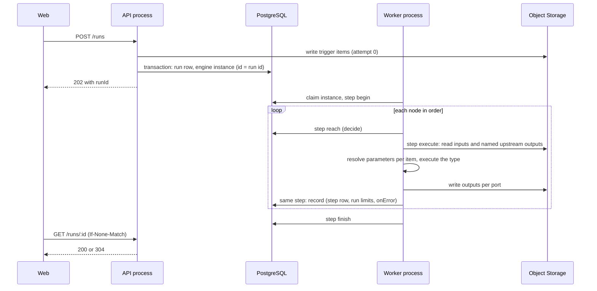
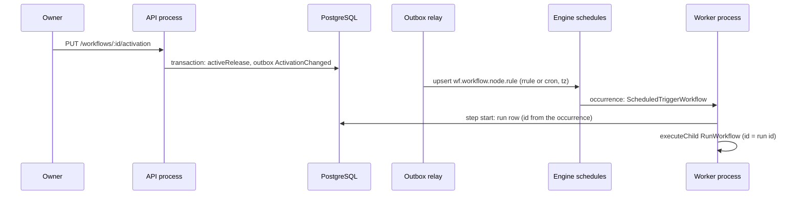

# Execution

## Run start

A use case decides and saves a queued `Run`; the adapter that serves the entry then starts one engine instance of `RunWorkflow` whose id is the run id. A run started by a trigger takes its id from the trigger key (`Run.newId(key)`: a UUIDv8 from the SHA-256 of the key), so a retried start finds the run it already made.

| Trigger      | Entry                                                                                                                                                      | Run id                                                      | Response                     |
| ------------ | ---------------------------------------------------------------------------------------------------------------------------------------------------------- | ----------------------------------------------------------- | ---------------------------- |
| Test, Manual | `POST /runs` (`target: { draft: { revision } }` or `{ release }`); `RunLauncher.launch` in the request's transaction                                       | random                                                      | `202 { runId }`              |
| Schedule     | Engine schedule `wf.<workflow>.<node>.<rule>` → `ScheduledTriggerWorkflow`: step `start` (`StartScheduledRun`), then `ctx.executeChild(RunWorkflow)`       | from `schedule:<occurrence instance id>`                    | —                            |
| Webhook      | `ALL /webhooks/:endpointId` → `WebhookIngressGuard` → `@Idempotent` (`x-delivery-id`, 7 days) → `StartWebhookRun`, `RunLauncher.launch` in the transaction | from `webhook:<endpoint>:<delivery id>`, random without one | `202 { runId }` after commit |

Schedules follow activation: activating, deactivating or archiving records `ActivationChanged`, the outbox delivers it to `ActivationHandler`, and `ScheduleRegistrar` upserts one engine schedule per rule of each Schedule Trigger of the active release (`missed: 'skip'`, `overlap: 'skip'`) and removes the others. Because the scheduled instance waits for its run, an occurrence due while the rule's previous run is active is skipped (FR-026).

Webhook ingress answers every refusal with the same `404` (unknown endpoint, inactive or archived workflow, node not in the active release, wrong method, wrong token, bad or stale signature, unreadable secret). Only an authenticated call learns of `413` (body above 1 MB) or `400` (JSON nested deeper than 64 levels).

## Execute run

`RunWorkflow` is the engine entry adapter. Each engine step runs its use cases inside a CLS context; every write runs in its own transaction, and the node execution runs outside one.

1. `begin` — `BeginRun` marks the run running and returns the node order from the firing trigger (Kahn's algorithm, ties by position). Its compensation calls `TerminateRun`: a timeout ends the run as `timeout`, a cancel as `cancelled`, any other engine failure as `platform`.
2. For each node:
   - `reach:<node>` — `ReachNode` decides in the domain: `Execute`, `Done` (trigger, skipped, disabled, pinned in a test run, already finished) or `Stop` (the run finished or was cancelled).
   - `execute:<node>` — `ExecuteNode` runs `NodeExecutor` outside a transaction (never for a run that already ended) and asks `Node.retryDelay`; a wait becomes a `NodeRetry` error whose backoff is that wait (up to 100 engine attempts; any other error is retried 3 times). In the same engine step `RecordNode` completes or fails the step in a transaction (a version conflict re-runs only the record); `onError` decides whether the run continues, except that a `limit` failure always ends it; a test run records the fields of the output for the editor.
3. `finish` — `FinishRun` marks the run succeeded unless it already ended.

| Limit       | Source                                                                                              |
| ----------- | --------------------------------------------------------------------------------------------------- |
| Concurrency | `@Workflow('automation.run', { concurrency: { limit: 5, key: workflowId } })`, in order of queueing |
| Run timeout | The workflow setting (1 s to 30 days), the instance's `timeout`                                     |
| Step output | 10,000 items and 16 MB per port (`limit` failure)                                                   |
| Run output  | 256 MB over all executed steps (`Run.complete`)                                                     |
| Journal     | Two entries per node plus `begin` and `finish`; far below the engine's 10,000                       |

## Data between nodes

| Aspect       | Rule                                                                                                                                                                                          |
| ------------ | --------------------------------------------------------------------------------------------------------------------------------------------------------------------------------------------- |
| Format       | A node output is a list of JSON items per port, stored as JSON Lines chunks of 500 items or 4 MiB under `runs/<run>/nodes/<node>/a<attempt>/<port>/<i>.jsonl`                                 |
| Database     | Step rows hold output references only (`port`, `items`, `bytes`, `key`, `chunkStarts`)                                                                                                        |
| Contract     | Connections carry no types. The consuming node's parameter schema with the user's bindings is checked per item when it runs; a mismatch is a `user` failure naming the parameter and the item |
| Bindings     | A fixed value, a field of an upstream node (`{ ref: { node, path } }`) or a formula (`{{ }}`); only the upstream nodes a parameter names are read                                             |
| Error output | With `onError: errorOutput`, a failing node sends its input items to port `error` with the message                                                                                            |
| Known fields | A test run records the field paths of each node's main output (first 20 items, at most 500 paths) for the editor; a pin keeps its own fields                                                  |

## Status and reads

| Aspect      | Rule                                                                                                                                                                                                                                                                 |
| ----------- | -------------------------------------------------------------------------------------------------------------------------------------------------------------------------------------------------------------------------------------------------------------------- |
| Run status  | `queued → running → succeeded`; terminal alternatives `failed`, `cancelled`                                                                                                                                                                                          |
| Writes      | Run and step rows are written by the engine steps; optimistic `version` checks; only changed steps are written                                                                                                                                                       |
| Cancel      | `POST /runs/:id/cancel` commits `Run.cancel` first, then calls the engine `cancel()`; no further node starts, a node already executing records its output, and a step left running (a node waiting for a retry) is closed as `cancelled`                             |
| Maintenance | Every minute: an unfinished run untouched for a minute whose engine instance ended is ended by that instance's error (`timeout`, `cancelled`, else `platform`), or as `platform` when the instance is gone; engine schedules are reconciled with the active releases |
| Polling     | `GET /runs/:id` returns a weak `ETag` and `Cache-Control: no-cache`; `If-None-Match` answers `304`                                                                                                                                                                   |
| Lists       | `GET /workflows/:id/runs` is keyset-paged by queue time                                                                                                                                                                                                              |
| Step output | `GET /runs/:id/steps/:nodeId/output?port=&offset=&limit=` pages items across the step's chunks; clients never access Object Storage; `503` while storage is down                                                                                                     |

## Retention

Planned (feature F): a nightly job deletes the artifacts under `runs/<runId>/`, then step and run rows, then purges the engine store, by retention days and runs per workflow.

## Sequences

