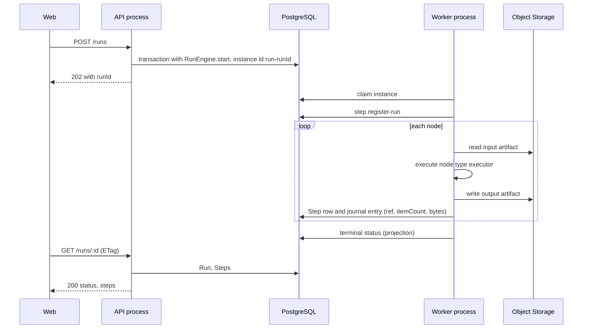
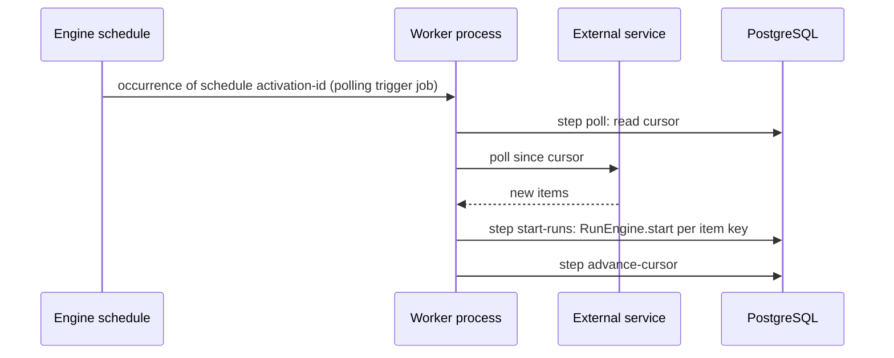

# Execution

## Run start

Every run starts through `RunEngine.start(RunWorkflow, input, { id: 'run-<runId>', transaction })`. The input is the snapshot of the published version and the trigger payload.

| Trigger  | Entry                                                                           | Instance id                  | Response           |
| -------- | ------------------------------------------------------------------------------- | ---------------------------- | ------------------ |
| Manual   | `POST /runs`                                                                    | generated run id             | `202 { runId }`    |
| Schedule | Runtime schedule `activation-<id>` on the run workflow, `overlap: 'skip'`       | `<scheduleId>@<time>`        | —                  |
| Webhook  | `POST /webhooks/:endpointId`; endpoint and signature verified                   | derived from the delivery id | `2xx` after commit |
| Polling  | Runtime schedule on the polling trigger job: poll → start runs → advance cursor | derived from the item key    | —                  |

## Execute run

The run workflow class is the engine entry adapter: it hands the input and a `StepRunner` to the use case _execute run_. The use case performs I/O only inside steps, so every replay repeats the same decisions.

1. Step `register-run` creates the Run row.
2. The use case visits nodes in topological order; each node is one durable step `node:<nodeId>` that invokes the use case _execute node step_:
   read inputs by artifact reference → execute the node type executor → write the output artifact under a key derived from the step idempotency key → write the Step row → return `{ ref, itemCount, bytes }` to the journal.
3. The run progress (current node, completed nodes) is published through `StepRunner.setStatus`.
4. Retry, timeout and backoff per step come from the node type manifest. Invalid user data raises `NonRetryableStepError`. The step idempotency key is passed to the external service where supported.

| Limit       | Source                                                        |
| ----------- | ------------------------------------------------------------- |
| Concurrency | `concurrency: { limit, key: workflowId }` on the run workflow |
| Run timeout | Workflow setting, bounded by a platform maximum               |
| Journal     | Engine limits; a long loop continues in a new instance        |

## Data between nodes

| Aspect        | Rule                                                                                                                                  |
| ------------- | ------------------------------------------------------------------------------------------------------------------------------------- |
| Format        | Node output is an array of JSON items stored as JSON Lines in Object Storage                                                          |
| Executor mode | `item`, `batch` or `all`, declared in the manifest                                                                                    |
| Paging        | The worker reads inputs page by page and forms batches by item count and byte size; Code Node batches respect the sandbox input limit |
| Limits        | Maximum items and bytes per step and per run; exceeding returns a user-facing error                                                   |
| Database      | Step rows hold metadata and artifact references only                                                                                  |

## Status and reads

| Aspect         | Rule                                                                                                          |
| -------------- | ------------------------------------------------------------------------------------------------------------- |
| Run status     | `queued → running → waiting → succeeded`; terminal alternatives `failed`, `cancelled`                         |
| Writes         | Run and Step rows are written inside steps; terminal transitions are projected from `WorkflowEvents.events$`  |
| Reconciliation | `GET /runs/:id` for a non-terminal run compares the row with `getStatus()` and updates the row                |
| Cancel         | `POST /runs/:id/cancel` calls the engine `cancel()` and marks the cancel request on the row                   |
| Polling        | `GET /runs/:id` returns `ETag` and `Cache-Control`; the client polls every 2 s until a terminal status        |
| Lists          | `GET /workflows/:id/runs` is paged                                                                            |
| Step output    | `GET /runs/:id/steps/:nodeId/output?page=` pages items from the artifact; clients never access Object Storage |

## Retention

| Aspect   | Rule                                                                                                           |
| -------- | -------------------------------------------------------------------------------------------------------------- |
| Policy   | Global: retention days and maximum runs per workflow                                                           |
| Job      | Retention job on a declared nightly schedule; one instance per occurrence                                      |
| Order    | Delete artifacts under `runs/<runId>/` → delete Step and Run rows → `purge({ olderThan })` on the engine store |
| Batching | Fixed batch size per step; the job continues in a new instance when the batch limit is reached                 |

## Sequences

