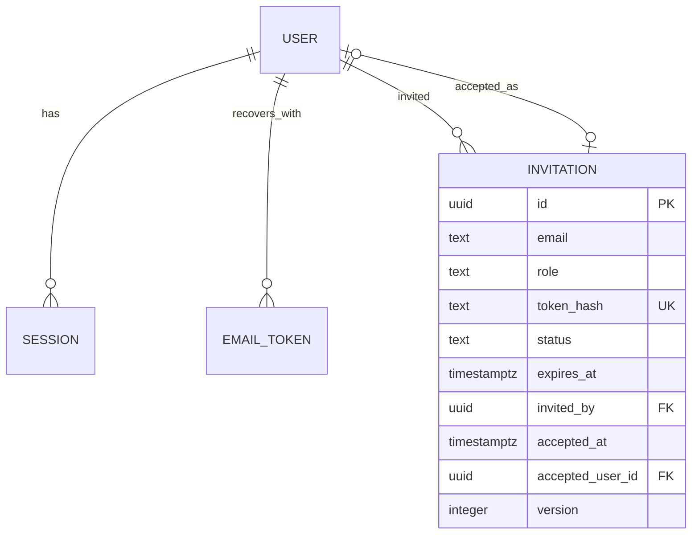

# Data Model: API Authentication

Bounded context: Identity & Access. Four application tables in the Drizzle schema; the `session`
and `email_token` tables implement the store contracts of `@nestjs/authentication`.

## Domain model

| Element         | Kind           | Fields                                                                                                                                                | Rules                                                                                                                                                                                                                                                                                |
| --------------- | -------------- | ----------------------------------------------------------------------------------------------------------------------------------------------------- | ------------------------------------------------------------------------------------------------------------------------------------------------------------------------------------------------------------------------------------------------------------------------------------ |
| Invitation      | aggregate root | `id`, `email`, `role`, `tokenHash`, `status`, `expiresAt`, `invitedBy`, `acceptedAt`, `acceptedUserId`, `createdAt`, `revokedAt`, `version`           | Private fields, getters, state changes only through `accept(userId)` and `revoke()`; accept allowed only while pending and before `expiresAt` (exclusive); violations throw `InvitationUsedError`, `InvitationRevokedError`, `InvitationExpiredError`; `create()` returns the entity |
| InvitationToken | value object   | `value` (32 random bytes, base64url), `hash` (SHA-256 of the value)                                                                                   | Generated by `InvitationToken.generate()` for a new link, rebuilt with `new InvitationToken(value)` from an incoming link; the invitation keeps only `hash`, the repository looks up by it                                                                                           |
| User            | entity         | `id`, `email`, `name`, `role`, `passwordHash`, `suspended`, `createdAt`                                                                               | Private fields, getters (`isAdmin`, `suspended`), `changePassword(hash)`; created by `AcceptInvitation` with the invitation's role                                                                                                                                                   |
| RoleName        | type           | `admin`, `editor`, `viewer`                                                                                                                           | Closed set; validated at the HTTP boundary                                                                                                                                                                                                                                           |
| Errors          | classes        | `InvitationNotFoundError`, `InvitationUsedError`, `InvitationRevokedError`, `InvitationExpiredError`, `AccountExistsError`, `InvitationConflictError` | Thrown by the entities, the use cases and the repositories; `DomainErrorFilter` maps each class to a Nest `HttpException` (404, 409, 410)                                                                                                                                            |

`InvitationPolicy` decides on `User.isAdmin`; `AuthenticateUser` refuses `suspended` users; the `version` is carried by the entity and checked by the repository.

Invitation status transitions:

```text
pending --accept (before expiresAt)--> accepted
pending --revoke--> revoked
pending --(expiresAt reached)--> expired (derived at read time; no stored transition)
```

Email format, role membership and the password length (12–128) are validated by the request DTOs at
the HTTP boundary. Sessions and recovery tokens are records of `@nestjs/authentication`, stored by
`DrizzleSessionStore` and `DrizzleEmailTokenStore`.

## Tables

| Table         | Column                                       | Type        | Constraints                                                                   |
| ------------- | -------------------------------------------- | ----------- | ----------------------------------------------------------------------------- |
| `user`        | `id`                                         | uuid        | primary key                                                                   |
|               | `email`                                      | text        | unique; stored lower-cased                                                    |
|               | `name`                                       | text        | not null                                                                      |
|               | `role`                                       | text        | check in (`admin`, `editor`, `viewer`)                                        |
|               | `password_hash`                              | text        | null until the first password (seeded administrator); scrypt, self-describing |
|               | `suspended`                                  | boolean     | not null, default false                                                       |
|               | `created_at`                                 | timestamptz | not null, default now                                                         |
| `session`     | `id`                                         | text        | primary key; SHA-256 of the cookie token                                      |
|               | `user_id`                                    | uuid        | references `user.id`, cascade                                                 |
|               | `created_at`, `expires_at`, `last_active_at` | timestamptz | not null                                                                      |
|               | `mfa`                                        | text        | null (unused)                                                                 |
|               | `metadata`                                   | jsonb       | ip and user agent at sign-in                                                  |
| `email_token` | `id`                                         | text        | primary key; SHA-256 of the link token                                        |
|               | `purpose`                                    | text        | `password-reset`                                                              |
|               | `user_id`                                    | uuid        | references `user.id`, cascade                                                 |
|               | `email`                                      | text        | address the link was sent to                                                  |
|               | `fingerprint`                                | text        | fingerprint of the password hash the link replaces                            |
|               | `created_at`, `expires_at`                   | timestamptz | not null                                                                      |

## Invitation table

| Table        | Column             | Type        | Constraints                                                              |
| ------------ | ------------------ | ----------- | ------------------------------------------------------------------------ |
| `invitation` | `id`               | uuid        | primary key, generated                                                   |
|              | `email`            | text        | lower-cased; partial unique index where `status = 'pending'`             |
|              | `role`             | text        | check in (`admin`, `editor`, `viewer`)                                   |
|              | `token_hash`       | text        | unique; SHA-256 of the 32-byte random token                              |
|              | `status`           | text        | check in (`pending`, `accepted`, `revoked`)                              |
|              | `expires_at`       | timestamptz | not null; `created_at + 7 days`                                          |
|              | `invited_by`       | uuid        | references `user.id`                                                     |
|              | `accepted_at`      | timestamptz | null until accepted                                                      |
|              | `accepted_user_id` | uuid        | references `user.id`; null until accepted                                |
|              | `created_at`       | timestamptz | not null, default now                                                    |
|              | `revoked_at`       | timestamptz | null unless revoked                                                      |
|              | `version`          | integer     | not null, default 1; incremented by every update; optimistic concurrency |

`add` inserts a new invitation with `version = 1`; `update` writes
`SET …, version = version + 1 WHERE id = $id AND version = $loadedVersion`; zero rows is
`InvitationConflictError` (409). Every command runs in one request-scoped transaction opened at the
controller (`@Transactional()`), which also holds the outbox write.

## Bootstrap administrator

Migration `0001_bootstrap_administrator.sql` inserts one `user` row (`role = 'admin'`,
`password_hash = NULL`) when no administrator exists. The address is the session
setting `app.bootstrap_admin_email` if the migration runs with it, otherwise `admin@example.com`. The
first password is set through password recovery.

## Tables owned by `@nestjs/outbox`

Schema `nest_outbox` (`messages`, `dead_letters`, `inbox`), created and migrated by `nest-outbox
migrate` (automatically outside production). `OutboxMailTransport` writes one `mail` message (the rendered mail) per
invitation and per recovery request through `Outbox.add(tx, …)`; the relay delivers it to the SMTP
handler. These tables are not part of the Drizzle schema.

## Relationships



## Validation rules

| Rule                                        | Where enforced                                                                                                                                          |
| ------------------------------------------- | ------------------------------------------------------------------------------------------------------------------------------------------------------- |
| Pending invitations list                    | `InvitationQueries.listPending` reads raw rows with `status = 'pending' and expires_at > now()` in SQL; no entities are loaded for the read endpoint    |
| Password length 12–128                      | DTOs (`@Length(12, 128)`) of invitation acceptance, recovery completion and password change                                                             |
| Email format and case-insensitivity         | DTOs (`@IsEmail`, lower-cased by `@Transform`); the repository stores and matches lower-cased addresses                                                 |
| Invitation role in closed set               | DTO (`@IsIn(User.ROLES)`); check constraints on `user.role` and `invitation.role`                                                                       |
| One pending invitation per email            | Partial unique index; the create use case revokes the previous pending invitation first                                                                 |
| Invitation for an existing account refused  | `InviteUser` asks `UserRepository.findByEmail` and throws `AccountExistsError`                                                                          |
| Recovery link single use, 1 hour            | `email_token` consumed on completion; `passwordReset.ttl: '1h'`; a link is bound to the password hash it replaces                                       |
| Other sessions ended on recovery and change | `PasswordResetService.reset` revokes every session; `AuthController.updatePassword` rotates the caller's session and revokes the others                 |
| Suspended user refused                      | `AuthenticateUser` throws `UserSuspendedError`; `UserRepository.findActiveById` / `findActiveByEmail` exclude suspended users for sessions and recovery |
| Concurrent updates of one invitation        | `version` column; stale version → `InvitationConflictError` → 409                                                                                       |
| Signed-in user accepting an invitation      | The controller ends the carried session (`SignInService.signOut`) before the use case runs and signs the new account in afterwards                      |
| Invitation creation races for one email     | Partial unique index on pending email; the violation surfaces as a database error (500)                                                                 |
