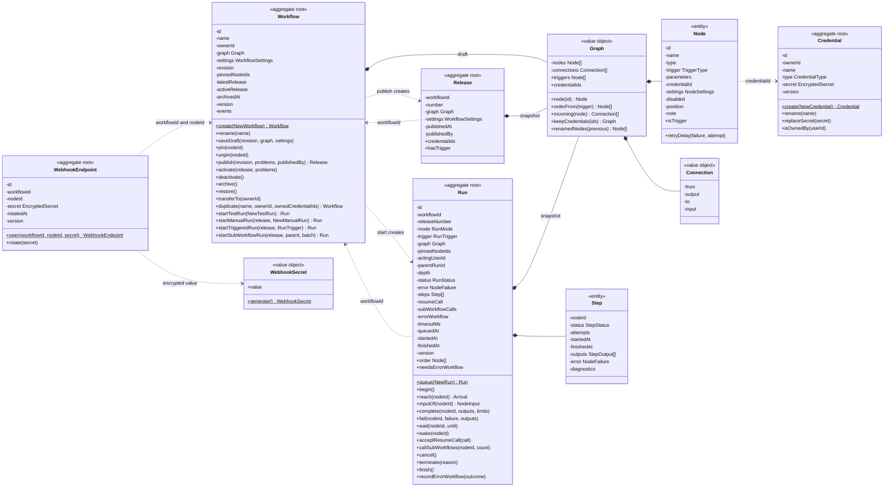

# Data Model: Workflow Builder and Core Nodes

Bounded context: Automation (docs/architecture/01-domain.md). The domain follows the conventions of the
Identity & Access context:

- Entities have `#private` fields, getters, a public constructor taking the props declared in
  `domain/interfaces.ts`, a static factory, and behaviour methods that throw domain errors.
- Aggregate roots carry `version` for optimistic concurrency, and repositories turn a stale update into a
  conflict error.
- A class exists only where there is behaviour or an invariant; plain data is a type in
  `domain/interfaces.ts`.

The domain imports no framework or library. It owns the life cycle of workflows, releases and runs and
the semantics of execution. It never reads the data that flows between nodes and never checks node
parameters: those are the expertise of the node types in the catalogue (interface adapters).

## Data between nodes

- **Connections**: a connection is an untyped pipe. It carries a list of items, which are opaque JSON
  objects.
- **The contract** belongs to the node that receives the items. It is the node type's parameter
  definitions together with the user's bindings: a fixed value, a field reference to an upstream node, or
  a formula (FR-015).
- **When it is checked**: when the node runs, the node executor resolves every binding for each item and
  checks the value against the parameter definition. A value that does not fit fails the node with a user
  error naming the parameter and the item, and the node's on-error setting applies.
- **Known output shapes** help the editor offer fields to pick and enforce nothing. They come from the
  pinned sample, the latest test run, or the output shape a node type declares.
- **Explicit schemas** exist only at boundaries the user declares: the declared input fields of an
  Execute Workflow Trigger, and webhook body schemas in a later feature.

## Domain model

### Language

| Term                       | Meaning                                                                                                                                                                        |
| -------------------------- | ------------------------------------------------------------------------------------------------------------------------------------------------------------------------------ |
| Workflow                   | A named automation with an owner. It holds the draft, the number of its latest release and the number of its active release                                                    |
| Draft                      | The editable graph and settings of a workflow; its revision grows with every save                                                                                              |
| Graph                      | Nodes and connections; always acyclic                                                                                                                                          |
| Node                       | An instance of a node type: identifier, unique name, type `id@version`, trigger kind (for trigger nodes), parameters (bindings), credential reference, settings, disabled flag |
| Connection                 | From an output of one node to an input of another; it has no data type                                                                                                         |
| Node type                  | A catalogue entry shipped with the platform: parameter definitions (the input contract), ports, output shape, accepted credential types, default settings, executor            |
| Binding                    | What a parameter is set to: a fixed value, a field reference or a formula, resolved for each item at run time                                                                  |
| Item                       | An opaque JSON object; nodes exchange lists of items                                                                                                                           |
| Node configuration problem | Why a node cannot run as configured: unknown type, parameter against its definition, formula, regular expression, port, credential                                             |
| Editor hint                | An orphan node, a dangling reference, an unknown field; computed by clients, never by the API                                                                                  |
| Pinned sample              | Items pinned on a draft node; a test run uses them instead of executing the node                                                                                               |
| Release                    | An immutable, numbered copy of the draft created by publishing; production runs execute releases                                                                               |
| Active release             | The release whose triggers (schedules, webhooks, error trigger) start runs; at most one per workflow                                                                           |
| Run                        | One execution of a graph snapshot: a test run of the draft or a production run of a release                                                                                    |
| Step                       | What happened to one node in a run: executed, skipped or failed                                                                                                                |
| Error kind                 | `user`, `limit`, `isolation`, `timeout`, `platform`, `cancelled` (FR-018)                                                                                                      |
| Acting user                | The workflow's owner when the run started; credentials open only for this user                                                                                                 |
| Webhook endpoint           | The stable public identifier and secret of one webhook node of a workflow                                                                                                      |

### Event storming

| Command (actor)                                                                      | Aggregate          | Fact                                                         | Reaction                                                               |
| ------------------------------------------------------------------------------------ | ------------------ | ------------------------------------------------------------ | ---------------------------------------------------------------------- |
| Create a workflow (editor)                                                           | Workflow           | created; the creator owns it                                 | —                                                                      |
| Save the draft (owner)                                                               | Workflow           | draft replaced, revision + 1                                 | new webhook nodes get endpoints                                        |
| Pin or unpin a sample (owner)                                                        | Workflow           | sample pinned or unpinned                                    | —                                                                      |
| Publish (owner)                                                                      | Workflow → Release | release N created                                            | —                                                                      |
| Activate or deactivate (owner)                                                       | Workflow           | active release changed                                       | `ActivationChanged` → outbox → engine schedules synchronised           |
| Archive or restore (owner)                                                           | Workflow           | archived (and deactivated) or restored                       | `ActivationChanged`                                                    |
| Transfer ownership (owner or administrator)                                          | Workflow           | owner changed                                                | —                                                                      |
| Duplicate (editor)                                                                   | Workflow (new)     | copy created                                                 | —                                                                      |
| Rotate a webhook secret (owner)                                                      | WebhookEndpoint    | secret replaced                                              | —                                                                      |
| Create, rename, replace the secret of, delete a credential (owner)                   | Credential         | changed                                                      | —                                                                      |
| Start a test run or a release run; a webhook call; a schedule occurrence; a sub-call | Workflow → Run     | run queued                                                   | the engine claims the run                                              |
| The engine claims the run                                                            | Run                | run started                                                  | —                                                                      |
| The run reaches a node                                                               | Run                | node skipped, passed its input on, used its pin, or executed | —                                                                      |
| A node fails                                                                         | Run                | step failed                                                  | on error: stop, continue, or continue through the error output         |
| A Wait node                                                                          | Run                | run waiting, then running                                    | —                                                                      |
| A resume call (external)                                                             | Run                | call accepted                                                | the engine wakes the run                                               |
| Cancel (owner)                                                                       | Run                | run cancelled                                                | the engine cancels waits and the sub-workflow runs it waits for        |
| Run timeout, limit or engine end                                                     | Run                | run failed                                                   | error workflow, for a production run that is not an error workflow run |
| Every node passed                                                                    | Run                | run succeeded                                                | —                                                                      |
| Night                                                                                | — (SQL)            | old runs removed                                             | —                                                                      |

Only `ActivationChanged` is a domain event in code: it is the one effect that leaves the database
transaction, because engine schedule upserts are not transactional. It is collected on the aggregate,
written to the outbox in the same transaction, and its handler converges the engine schedules to the
current active release. Every other reaction is an explicit flow in a use case.

### Use cases

- **Viewer**: read the catalogue, workflows, releases, runs and step output.
- **Editor**: create a workflow, duplicate any workflow, manage own credentials.
- **Owner or administrator**:
  - rename, save the draft, pin and unpin samples;
  - publish, activate, deactivate, archive, restore;
  - transfer ownership, rotate a webhook secret;
  - start a test run or a release run, cancel a run.
- **Administrator**: the retention policy; deleting any credential.
- **External callers**: webhook calls, resume calls.
- **Time**: schedule occurrences, the nightly retention job.
- **The engine**: begin a run, reach a node, execute it, record the result, wait, call sub-workflows,
  finish, terminate.

### Aggregates

| Aggregate           | Consistency it keeps                                                                                                           | Why it is its own aggregate                                                                                                                                                                                                                                                                                                                                                                            |
| ------------------- | ------------------------------------------------------------------------------------------------------------------------------ | ------------------------------------------------------------------------------------------------------------------------------------------------------------------------------------------------------------------------------------------------------------------------------------------------------------------------------------------------------------------------------------------------------ |
| **Workflow**        | Owner, archive, draft and revision (conflicts), pinned nodes, release numbering, one active release, the gates that start runs | "One active release" is the field `activeRelease`; no Activation aggregate is needed                                                                                                                                                                                                                                                                                                                   |
| **Release**         | An immutable copy of the graph and settings that production runs execute (FR-012)                                              | The draft keeps changing, while schedules and webhooks must run exactly what was published, so publishing freezes the draft into release N. Releases are many and each holds a whole graph; inside Workflow they would load on every draft save, yet they need no guarding because they never change. Workflow keeps only `latestRelease` and `activeRelease`, and a run refers to a release by number |
| **Run** (with Step) | States, node order, skips, on-error handling, the run size limit, cancellation, waits, sub-workflow calls                      | Its own life cycle; it holds the graph snapshot and every step its decisions need                                                                                                                                                                                                                                                                                                                      |
| **Credential**      | Owner, type, encrypted secret                                                                                                  | Its own life cycle and owner                                                                                                                                                                                                                                                                                                                                                                           |
| **WebhookEndpoint** | The stable address and secret of a (workflow, node) pair; rotation                                                             | The address outlives drafts, releases and activations; rotating the secret never conflicts with saving the draft; ingress loads it by its public identifier without the draft                                                                                                                                                                                                                          |

### Classes

| Class           | Kind                      | State                                                                                                                                                                                                                                                                                        | Behaviour and rules                                                                                                                                                                                                                                                                                                                                                                                                                                                                                                                                                                                                                                                                                                                                                                                                                                                                                                                                                                                                                                                                                                                                                                                                                                                                  |
| --------------- | ------------------------- | -------------------------------------------------------------------------------------------------------------------------------------------------------------------------------------------------------------------------------------------------------------------------------------------- | ------------------------------------------------------------------------------------------------------------------------------------------------------------------------------------------------------------------------------------------------------------------------------------------------------------------------------------------------------------------------------------------------------------------------------------------------------------------------------------------------------------------------------------------------------------------------------------------------------------------------------------------------------------------------------------------------------------------------------------------------------------------------------------------------------------------------------------------------------------------------------------------------------------------------------------------------------------------------------------------------------------------------------------------------------------------------------------------------------------------------------------------------------------------------------------------------------------------------------------------------------------------------------------ |
| Workflow        | aggregate root            | `id`, `name`, `ownerId`, `graph`, `settings`, `revision`, `pinnedNodeIds`, `latestRelease`, `activeRelease`, `archivedAt`, `createdAt`, `updatedAt`, `version`, events                                                                                                                       | `create(NewWorkflow)` gives an empty draft owned by the creator. `rename(name)`. `saveDraft(revision, graph, settings)` refuses a stale revision (`WorkflowConflictError`), replaces graph and settings, unpins nodes that are gone, and increments the revision. `pin(nodeId)` and `unpin(nodeId)`: only nodes of the draft. `publish(revision, problems, publishedBy)` refuses a stale revision and any node configuration problem (`NodeConfigurationError`) and returns release `latestRelease + 1`. `activate(release, problems)` refuses an archived workflow, a release without a trigger and any problem, sets `activeRelease` and records `ActivationChanged`. `deactivate()`, `archive()` (deactivates), `restore()`. `transferTo(ownerId)`. `duplicate(name, ownerId, ownedCredentialIds)` returns a new workflow whose graph keeps only the copier's credentials. Runs: `startTestRun(NewTestRun)` (not archived, current revision, no problems, the named node is a trigger), `startManualRun(release, NewManualRun)` (not archived, the named node is a trigger of the release), `startTriggeredRun(release, RunTrigger)` (only the active release), `startSubWorkflowRun(release, parent, batch)` (the latest release, which starts with an Execute Workflow Trigger) |
| Release         | aggregate root, immutable | `workflowId`, `number`, `graph`, `settings`, `publishedAt`, `publishedBy`                                                                                                                                                                                                                    | Created only by `Workflow.publish`. `credentialIds` for the activation re-check and the credential deletion rule; `hasTrigger`                                                                                                                                                                                                                                                                                                                                                                                                                                                                                                                                                                                                                                                                                                                                                                                                                                                                                                                                                                                                                                                                                                                                                       |
| Graph           | value object              | `nodes`, `connections`                                                                                                                                                                                                                                                                       | The constructor guarantees the form: unique node identifiers, unique node names (formulas name nodes), connections between nodes of the graph, no cycle (`InvalidGraphError` with every reason). `node(id)`, `triggers`, `credentialIds`, `orderFrom(trigger)`: the nodes reachable from the trigger in dependency order (Kahn's algorithm, ties broken by position, then identifier). `incoming(node)`. `keepCredentials(ids)` returns a graph without the other credential references. `renamedNodes(previous)` lists nodes whose name changed, so formulas can be rewritten                                                                                                                                                                                                                                                                                                                                                                                                                                                                                                                                                                                                                                                                                                       |
| Node            | entity of Graph           | `id`, `name`, `type`, `trigger` (`TriggerType` or null, from the catalogue), `parameters` (bindings, opaque to the domain), `credentialId`, `settings`, `disabled`, `position`, `note`                                                                                                       | `isTrigger`. `retryDelay(failure, attempt)`: never for `limit` and `isolation`; `platform` up to 3 attempts with back-off, or up to 15 minutes for an unknown node type version; `user` up to the configured attempts after the configured wait (FR-016, FR-021)                                                                                                                                                                                                                                                                                                                                                                                                                                                                                                                                                                                                                                                                                                                                                                                                                                                                                                                                                                                                                     |
| Connection      | value object              | `from`, `output`, `to`, `input`                                                                                                                                                                                                                                                              | —                                                                                                                                                                                                                                                                                                                                                                                                                                                                                                                                                                                                                                                                                                                                                                                                                                                                                                                                                                                                                                                                                                                                                                                                                                                                                    |
| Run             | aggregate root            | `id`, `workflowId`, `releaseNumber` (null for a test run), `mode`, `trigger`, `graph`, `pinnedNodeIds`, `actingUserId`, `parentRunId`, `depth`, `status`, `error`, `steps`, `resumeCall`, `subWorkflowCalls`, `errorWorkflow`, `timeoutMs`, `queuedAt`, `startedAt`, `finishedAt`, `version` | `queue(NewRun)` derives the identifier from the trigger key when there is one, so a delivery, occurrence, sub-call or failed run maps to one run. `begin()`. `order`. `reach(nodeId)` returns an `Arrival` (see below). `inputOf(nodeId)` returns the `NodeInput`: the upstream outputs per input port, `firstItemOnly` (execute once) and `emptyItemWhenSilent` (always output data). `complete(nodeId, outputs, limits)` records the outputs and fails the run when its outputs exceed the run limit; a node that finishes after a cancellation keeps its output. `fail(nodeId, failure, outputs)` applies the node's on-error setting. `wait(nodeId, until)`, `wake(nodeId)`. `acceptResumeCall(call)` keeps the first call and refuses later ones and calls after the end (`ResumeRefusedError`). `callSubWorkflows(nodeId, count)` fails the node with `limit` beyond depth 5, 1,000 calls per execution or 4,000 per run. `cancel()` (`RunFinishedError` when finished). `terminate(reason)`: an engine-side end; a terminal run stays unchanged. `finish()`. `needsErrorWorkflow`, `recordErrorWorkflow(outcome)`                                                                                                                                                             |
| Step            | entity of Run             | `nodeId`, `status` (`running`, `succeeded`, `failed`, `skipped`), `attempts`, `startedAt`, `finishedAt`, `outputs`, `error`, `diagnostics`                                                                                                                                                   | Changes only through Run                                                                                                                                                                                                                                                                                                                                                                                                                                                                                                                                                                                                                                                                                                                                                                                                                                                                                                                                                                                                                                                                                                                                                                                                                                                             |
| Credential      | aggregate root            | `id`, `ownerId`, `name`, `type`, `secret` (EncryptedSecret), `createdAt`, `updatedAt`, `version`                                                                                                                                                                                             | `create(NewCredential)`, `rename(name)`, `replaceSecret(secret)`, `isOwnedBy(userId)`. The plain secret never enters the domain                                                                                                                                                                                                                                                                                                                                                                                                                                                                                                                                                                                                                                                                                                                                                                                                                                                                                                                                                                                                                                                                                                                                                      |
| WebhookEndpoint | aggregate root            | `id` (public, 32 random bytes, base64url), `workflowId`, `nodeId`, `secret` (EncryptedSecret), `createdAt`, `rotatedAt`, `version`                                                                                                                                                           | `open(workflowId, nodeId, secret)`, `rotate(secret)`                                                                                                                                                                                                                                                                                                                                                                                                                                                                                                                                                                                                                                                                                                                                                                                                                                                                                                                                                                                                                                                                                                                                                                                                                                 |
| WebhookSecret   | value object              | the secret value                                                                                                                                                                                                                                                                             | `generate()`: 32 random bytes. The application encrypts it through `SecretCipher`, like `InvitationToken`                                                                                                                                                                                                                                                                                                                                                                                                                                                                                                                                                                                                                                                                                                                                                                                                                                                                                                                                                                                                                                                                                                                                                                            |

`Run.reach(nodeId)` decides in this order:

1. The run is finished or cancelled: `Stop`.
2. The node already has a finished step: `Done`, so a repeated engine step changes nothing (FR-020).
3. The node is the run's trigger: the step succeeds with the trigger input written when the run was
   queued, or with the pin in a test run without input. Returns `Done`.
4. No input received items and the node does not always output data: the step is skipped. Returns `Done`.
5. The node is disabled: the step succeeds and passes the items of its first input on. Returns `Done`.
6. A test run reaches a pinned node: the step succeeds with the pin. Returns `Done`.
7. Otherwise the step starts its next attempt. Returns `Execute`.

Data types in `domain/interfaces.ts`: `NodeSettings` (`alwaysOutputData`, `executeOnce`, `retry`
`{ attempts, waitMs }`, `onError`), `WorkflowSettings` (`timezone`, `runTimeoutMs`, `errorWorkflowId`),
`RunTrigger` (`type`, `nodeId`, `key`), `NodeFailure` (`kind`, `nodeId`, `parameter`, `item`, `message`),
`StepOutput` (`port`, `items`, `bytes`, `chunkStarts`, `attempt`), `NodeInput`, `EncryptedSecret`
(`ciphertext`, `keyVersion`), `ResumeCall`, `ErrorWorkflowOutcome`, `Problem` (`nodeId`, `parameter`,
`code`, `message`), `RunLimits`, and the props and `NewX` inputs of every class.

Enumerations in `domain/enums.ts`: `RunStatus`, `RunMode`, `StepStatus`, `ErrorKind`, `OnError`,
`TriggerType` (`manual`, `schedule`, `webhook`, `subWorkflow`, `error`), `CredentialType`, `ProblemCode`,
`Arrival` (`Execute`, `Done`, `Stop`).

Outside the domain: the node type catalogue, parameter schemas, formulas and executors (interface
adapters); the known fields of nodes (a read model); the retention policy (settings and SQL).

`Node.trigger` comes from the catalogue when the application builds the graph on save, is stored with
the node, and is never set by the client. The domain therefore decides alone about starting runs,
activation, error workflows, sub-workflows and webhook endpoints.

### Class diagram



### Rules and their owners

Every rule has one owner.

**Draft and graph**

| Rule                                                                                                                           | Owner                                                                                                 |
| ------------------------------------------------------------------------------------------------------------------------------ | ----------------------------------------------------------------------------------------------------- |
| The creator owns the workflow (FR-001)                                                                                         | `Workflow.create`                                                                                     |
| A draft holds nodes, connections and workflow settings (FR-006)                                                                | `Workflow`, `Graph`, `Node`, `Connection`, `WorkflowSettings`                                         |
| Who creates and who manages (FR-001, FR-003, FR-046)                                                                           | `WorkflowPolicy`                                                                                      |
| A save replaces the whole draft; a stale revision is a conflict; the revision grows (FR-008)                                   | `Workflow.saveDraft`                                                                                  |
| The form of the graph: unique identifiers and names, connections between its nodes, no cycle (FR-007)                          | `Graph` constructor                                                                                   |
| 200 nodes, 256 KB of parameters per node, 5 MB per request (FR-009)                                                            | request validation (interface adapters)                                                               |
| Unknown type, parameter against its definition, regular expression, formula syntax and scope, unknown port, second resume Wait | the node types of the catalogue (interface adapters), collected by `ConfigurationCheck` (application) |
| Missing, foreign or mismatched credentials (FR-042)                                                                            | `ConfigurationCheck` (catalogue and `CredentialRepository`)                                           |
| Unreachable node, reference to a node that is missing or not upstream, unknown field, missing error workflow                   | editor hints (clients); at run time: never runs, resolves to empty, recorded as unavailable (FR-029)  |
| Default settings of the node type (FR-013, FR-016)                                                                             | `SaveDraft` fills them from the catalogue when it builds the graph                                    |
| Renaming a node rewrites `$('old name')` in formulas                                                                           | `SaveDraft`: `Graph.renamedNodes` finds the renames, the `FormulaEngine` port rewrites                |
| A pin belongs to a node of the draft and goes with it                                                                          | `Workflow.pin`, `Workflow.saveDraft`                                                                  |
| A pin holds at most 100 items, 1 MB, 64 levels                                                                                 | request validation                                                                                    |

**Releases and activation**

| Rule                                                                                                                          | Owner                                                                                          |
| ----------------------------------------------------------------------------------------------------------------------------- | ---------------------------------------------------------------------------------------------- |
| Publishing names the current revision, refuses node configuration problems, numbers the release, which never changes (FR-010) | `Workflow.publish`, with the problems from `ConfigurationCheck`                                |
| One active release, which has a trigger (FR-011)                                                                              | `Workflow.activate`                                                                            |
| Activation re-checks the release's credentials (FR-011)                                                                       | `ConfigurationCheck` on the release's graph → `Workflow.activate(release, problems)`           |
| Archiving deactivates; an archived workflow is neither run nor activated (FR-003)                                             | `Workflow.archive` and the guards of `start*` and `activate`                                   |
| Triggers take effect within a minute and are reconciled (FR-011)                                                              | the outbox handler of `ActivationChanged` and the maintenance workflow                         |
| A copy belongs to the copier and keeps only the copier's credentials (FR-004)                                                 | `Workflow.duplicate` with `Graph.keepCredentials`, the credential ids gathered by the use case |
| Ownership goes only to an editor or an administrator (FR-005)                                                                 | `TransferWorkflow` (looks up the user) → `Workflow.transferTo`                                 |
| A webhook node keeps its address from its first save (FR-027)                                                                 | `SaveDraft` → `WebhookEndpoint.open`; unique index on (`workflow_id`, `node_id`)               |

**Runs and execution**

| Rule                                                                                                                  | Owner                                                                                                   |
| --------------------------------------------------------------------------------------------------------------------- | ------------------------------------------------------------------------------------------------------- |
| A test run: current revision, no problems, the named node is a trigger, not archived (FR-017)                         | `Workflow.startTestRun`                                                                                 |
| Triggers start runs of the active release only (FR-012); a manual run may use any release                             | `Workflow.startTriggeredRun`, `Workflow.startManualRun`                                                 |
| A run keeps its graph snapshot and acting user (FR-017)                                                               | `Run.queue`                                                                                             |
| Manual Trigger input: 1,000 items, 1 MB, 64 levels, opaque objects (FR-025)                                           | request validation                                                                                      |
| Schedule rules and time zones; one run per occurrence; an overlapping occurrence of the same rule is skipped (FR-026) | the Schedule Trigger node type and the engine schedules (`overlap: 'skip'`, `missed: 'skip'`)           |
| An Execute Workflow Trigger takes the caller's items or checks them against its declared input fields (FR-028)        | the node type, as the data contract at a boundary                                                       |
| The behaviour of every core node, including Code and HTTP Request (FR-014, FR-032, FR-034, FR-035, FR-036)            | the node types (interface adapters) behind the `NodeExecutor` port                                      |
| One run per delivery, occurrence, sub-call or failed run                                                              | the identifier derived by `Run.queue`, the primary key, `@nestjs/idempotency` for webhooks              |
| States and transitions (FR-018)                                                                                       | `Run`                                                                                                   |
| Dependency order from the firing trigger; a node waits for every upstream node; skips; several inputs (FR-019)        | `Graph.orderFrom`, `Run.reach`                                                                          |
| Disabled, execute once, always output data, pins in test runs (FR-016, FR-021)                                        | `Run.reach`, `Run.inputOf`                                                                              |
| On error: stop, continue, error output (FR-016)                                                                       | `Run.fail`                                                                                              |
| Retry policy (FR-016, FR-021)                                                                                         | `Node.retryDelay`; the engine waits and repeats                                                         |
| A finished node never runs again (FR-020)                                                                             | `Run.reach` and the engine journal                                                                      |
| The data contract: resolved bindings checked against the type's parameter definitions per item (FR-015)               | the node executor (interface adapters) → `NodeFailure` of kind `user` naming the parameter and the item |
| 10,000 items and 16 MB per step (FR-022)                                                                              | the output writer (interface adapters) → `NodeFailure` of kind `limit`                                  |
| 256 MB per run (FR-022)                                                                                               | `Run.complete`                                                                                          |
| Run timeout (FR-022)                                                                                                  | the engine timer → `Run.terminate`                                                                      |
| Five executing runs per workflow, oldest first (FR-023)                                                               | the engine's concurrency key                                                                            |
| Cancellation (FR-024)                                                                                                 | `Run.cancel`, `Run.reach`, `Run.complete`; the engine cancels waits and sub-workflow runs               |
| Credentials open only for the acting user (FR-005, FR-040)                                                            | `ExecuteNode` with `Credential.isOwnedBy(run.actingUserId)`                                             |
| Error workflows (FR-029)                                                                                              | `Run.needsErrorWorkflow`, `Workflow.startTriggeredRun`; the use case records the outcome                |
| Resume calls (FR-030)                                                                                                 | `Run.acceptResumeCall`; the address signature through the `Signer` port                                 |
| Sub-workflow limits (FR-031)                                                                                          | `Run.callSubWorkflows`, `Workflow.startSubWorkflowRun`                                                  |
| Code sandbox, SSRF, pagination, formula bounds (FR-015, FR-033, FR-037, FR-038)                                       | interface adapters: sandbox gateway, outbound HTTP, HTTP Request executor, formula engine               |

**Credentials, webhooks, retention**

| Rule                                                                                                   | Owner                                                                                    |
| ------------------------------------------------------------------------------------------------------ | ---------------------------------------------------------------------------------------- |
| Secrets are encrypted, write-only and never shown (FR-040)                                             | the `SecretCipher` port; presenters never map a secret                                   |
| A credential name is unique per owner                                                                  | unique index → 409                                                                       |
| The generic HTTP credential types and their secret fields; the creator owns the credential (FR-039)    | request validation, `Credential.create`                                                  |
| Lists of workflows and runs: order, paging, filters (FR-002, FR-043)                                   | queries in SQL, which never load aggregates (constitution V)                             |
| A credential referenced by an active release cannot be deleted (FR-041)                                | `DeleteCredential`: a rule that needs a lookup lives in the use case, as in `InviteUser` |
| Webhook authentication, the uniform "not found", body size and depth, clock skew, delivery id (FR-027) | the ingress guard, the idempotency interceptor and the request model                     |
| Retention values, administrators only, unfinished runs kept (FR-044, FR-045)                           | request validation, `SettingsPolicy`, the repository method `deleteFinishedBefore` (SQL) |

### Checks by layer

| Where                      | What it checks                                                                                                                     | Answer                               |
| -------------------------- | ---------------------------------------------------------------------------------------------------------------------------------- | ------------------------------------ |
| Request model, guard, pipe | What one request decides without state: types, presence, formats, enumerations, lengths, ranges, the size and depth of opaque data | 400; webhooks answer the uniform 404 |
| Policy                     | Who may act                                                                                                                        | 403                                  |
| Use case                   | Existence (`getX`); rules that need a lookup of another aggregate or of the catalogue; gathering facts for the domain              | 404, 409, 422                        |
| Domain                     | The aggregate's own state and the consistency of its parts; the decisions of execution                                             | 409, 422                             |
| Node type, node executor   | What node parameters mean (definitions, formulas, regular expressions), reported as problems; the data contract at run time        | problems; node failures              |
| Clients                    | Editor hints                                                                                                                       | —                                    |

| Command            | Request model                                                                                                                                                                                                                                                                             | Application                                                                                                                                                                 | Domain                                                                               |
| ------------------ | ----------------------------------------------------------------------------------------------------------------------------------------------------------------------------------------------------------------------------------------------------------------------------------------- | --------------------------------------------------------------------------------------------------------------------------------------------------------------------------- | ------------------------------------------------------------------------------------ |
| Create, rename     | name 1–120 characters                                                                                                                                                                                                                                                                     | author, manage                                                                                                                                                              | the creator owns it                                                                  |
| Save the draft     | JSON form: node id (UUID), name, type `id@version`, parameters as bindings, credential id, settings (attempts 1–5, wait 0–300,000 ms, on-error enumeration), position; connections; IANA time zone, timeout 1 s to 30 days, error workflow id; revision; 200 nodes, 256 KB per node, 5 MB | manage; trigger kinds and default settings from the catalogue; `ConfigurationCheck` → problems in the response; endpoints for new webhook nodes; formula rewrites on rename | revision; the form of `Graph`; pins of removed nodes go                              |
| Pin a sample       | 100 items, 1 MB, 64 levels, items are objects                                                                                                                                                                                                                                             | manage; store the items                                                                                                                                                     | the node is in the draft                                                             |
| Publish            | revision                                                                                                                                                                                                                                                                                  | manage; `ConfigurationCheck`                                                                                                                                                | revision, no problems, next number                                                   |
| Activate           | release number                                                                                                                                                                                                                                                                            | manage; the release exists; `ConfigurationCheck` on the release's credentials                                                                                               | not archived, the release has a trigger, no problems, one active release             |
| Start a test run   | revision, trigger node id, items (1,000, 1 MB, 64 levels)                                                                                                                                                                                                                                 | manage; `ConfigurationCheck`; store the input items                                                                                                                         | revision, no problems, the node is a trigger, not archived                           |
| Cancel a run       | run id (UUID)                                                                                                                                                                                                                                                                             | manage; the run exists                                                                                                                                                      | not finished                                                                         |
| Webhook call       | endpoint id, method, token or signature within 5 minutes, body 1 MB and 64 levels, `x-delivery-id` 1–255 characters                                                                                                                                                                       | endpoint, workflow, active release                                                                                                                                          | the active release contains the webhook node; the run id comes from the delivery key |
| Resume call        | token form and signature (`Signer`), body 1 MB and 64 levels, `Idempotency-Key`                                                                                                                                                                                                           | the run exists                                                                                                                                                              | one accepted call; the run is not finished                                           |
| Credentials        | name 1–120 characters, type, secret fields per type                                                                                                                                                                                                                                       | manage; encryption; deletion asks whether an active release refers to it                                                                                                    | rename, replace the secret                                                           |
| Transfer ownership | user id (UUID)                                                                                                                                                                                                                                                                            | manage; the target is an editor or an administrator                                                                                                                         | the new owner                                                                        |
| Retention          | days 1–3,650, maximum runs 1–1,000,000                                                                                                                                                                                                                                                    | administrators only                                                                                                                                                         | —                                                                                    |

### Run execution by layer

| Concern               | frameworks                                                                                                                          | interface-adapters                                                                                                                                                                                                                            | application                                                                                                                               | domain                                                                     |
| --------------------- | ----------------------------------------------------------------------------------------------------------------------------------- | --------------------------------------------------------------------------------------------------------------------------------------------------------------------------------------------------------------------------------------------- | ----------------------------------------------------------------------------------------------------------------------------------------- | -------------------------------------------------------------------------- |
| Process roles         | `main.ts`: `ROLE=api` serves HTTP, `ROLE=worker` runs an application context                                                        | —                                                                                                                                                                                                                                             | —                                                                                                                                         | —                                                                          |
| Engine                | `di/workflows-infra.module.ts`: `WorkflowsModule` on the PostgreSQL store, worker on or off, concurrency from the environment       | —                                                                                                                                                                                                                                             | —                                                                                                                                         | —                                                                          |
| Technology clients    | factories for S3, the undici agent with the SSRF guard and the go-judge client; the configuration schema (limits, keys, allow-list) | —                                                                                                                                                                                                                                             | —                                                                                                                                         | —                                                                          |
| Assembly              | `di/automation.module.ts`: ports bound to adapters, use case factories, node types as a multi-provider                              | —                                                                                                                                                                                                                                             | —                                                                                                                                         | —                                                                          |
| Queue a run over HTTP | —                                                                                                                                   | `RunsController`: request model, `@Can`, `@Transactional`; after the use case, `client.start('run-<id>', { timeout, transaction })`                                                                                                           | `StartTestRun`, `StartManualRun`: load, ask the policy, `ConfigurationCheck`, store the input through `ArtifactStore`, save the run       | `Workflow.start*` → `Run.queue`                                            |
| Webhook               | —                                                                                                                                   | ingress guard, `@Idempotent`, handler: the use case, then `client.start` in the transaction                                                                                                                                                   | `StartWebhookRun`                                                                                                                         | `Workflow.startTriggeredRun`                                               |
| Schedule              | —                                                                                                                                   | the outbox handler of `ActivationChanged` syncs engine schedules; the `scheduled-trigger` workflow runs the use case in a step, then `ctx.executeChild(run)`                                                                                  | `StartScheduledRun`                                                                                                                       | `Workflow.startTriggeredRun`                                               |
| Execution             | —                                                                                                                                   | `RunWorkflow` (`@Workflow`): steps `begin`, then `reach` and `execute` (execute, then record) per node, then `finish`; one transaction per write; `Node.retryDelay` becomes the engine's retry options; the compensation calls `TerminateRun` | `BeginRun`, `ReachNode`, `ExecuteNode` (credential → `SecretCipher` → the `NodeExecutor` port), `RecordNode`, `FinishRun`, `TerminateRun` | `Run.begin`, `reach`, `inputOf`, `complete`, `fail`, `finish`, `terminate` |
| Node execution        | —                                                                                                                                   | `NodeExecutor`: reads the inputs, resolves bindings through `FormulaEngine`, checks them against the type's definitions, runs the type, writes the outputs within the step limits, classifies errors by kind                                  | —                                                                                                                                         | —                                                                          |
| Wait, sub-workflows   | —                                                                                                                                   | orchestrating node adapters: `ctx.sleepUntil`, `waitForSignal`, `executeChild` and `startChild`, with use cases inside steps                                                                                                                  | `WaitRun`, `WakeRun`, `StartSubWorkflowRuns`                                                                                              | `Run.wait`, `wake`, `callSubWorkflows`; `Workflow.startSubWorkflowRun`     |
| Cancel, resume        | —                                                                                                                                   | the controller runs the use case, then `client.cancel` or `client.signal` in the transaction                                                                                                                                                  | `CancelRun`, `ResumeRun`                                                                                                                  | `Run.cancel`, `Run.acceptResumeCall`                                       |
| Error workflow        | —                                                                                                                                   | the `finish` step and the compensation start the error run through the client in the step's transaction                                                                                                                                       | `FinishRun`, `TerminateRun`: load the error workflow, start it or record it as unavailable                                                | `Run.needsErrorWorkflow`, `Workflow.startTriggeredRun`                     |
| Retention             | —                                                                                                                                   | the `retention` workflow                                                                                                                                                                                                                      | `ApplyRetention`                                                                                                                          | —                                                                          |

Why adapters start engine instances instead of a port:

- the constitution forbids re-declaring framework services as ports;
- the engine starts runs in several ways: `client.start` in a transaction for HTTP, webhooks and error
  workflows, and `ctx.executeChild` for schedules and sub-workflows, which no use case can reach;
- the use case decides and saves the queued `Run`, and the adapter starts the instance the way its entry
  requires.

Why every node takes two engine steps:

- `reach` decides in its own transaction;
- `execute` performs the long input and output without a transaction, then records the result in a
  transaction of its own, inside the same engine step, so a cancellation can never fall between the
  node's execution and its record;
- a conflict with a concurrent cancellation repeats only the record, never the node.

### Run status

```text
queued --begin--> running --Wait node--> waiting --wake or resume--> running
running --finish--> succeeded
running --a node fails with on error "stop", or the run limit--> failed
queued | running | waiting --cancel--> cancelled
queued | running | waiting --terminate (timeout, engine end)--> failed | cancelled
```

The compensation of the `begin` step calls `TerminateRun` when the engine ends an instance on its own, and
the maintenance workflow does the same for instances whose compensation was lost; a terminal run stays
unchanged. `GET /runs/{id}` never writes.

### Domain errors (new)

| Error                                                                                                                                                              | HTTP |
| ------------------------------------------------------------------------------------------------------------------------------------------------------------------ | ---- |
| `WorkflowNotFoundError`, `ReleaseNotFoundError`, `RunNotFoundError`, `CredentialNotFoundError`, `WebhookEndpointNotFoundError`, `NodeNotFoundError`                | 404  |
| `WorkflowAccessDeniedError`, `CredentialAccessDeniedError`                                                                                                         | 403  |
| `WorkflowConflictError` (stale revision or concurrent change), `RunConflictError`, `CredentialConflictError`, `CredentialInUseError`, `ResumeRefusedError`         | 409  |
| `WorkflowArchivedError`, `WorkflowInactiveError`, `RunFinishedError`                                                                                               | 409  |
| `InvalidGraphError` (carries every reason), `NodeConfigurationError` (carries the problems), `NotATriggerError`, `ReleaseWithoutTriggerError`, `InvalidOwnerError` | 422  |

`InvalidGraphError` and `NodeConfigurationError` carry data, unlike the parameterless errors of Identity
& Access, because FR-007 and FR-010 answer with every reason. Webhook ingress maps every refusal,
including `WorkflowInactiveError`, to the uniform 404 (FR-027). Node failures are data (`NodeFailure`)
recorded on the step and the run, never answered over HTTP. `DomainErrorFilter` maps each class
explicitly; an unmapped domain error is answered with 500.

### HTTP Request pagination parameters

The `pagination` parameter of the HTTP Request node (FR-037, research R23) is part of the node's parameter schema, not a domain aggregate. Its shape and rules are listed here because the web renders it and the node configuration check reports it. Every leaf is a binding; the leaves marked "formula" accept `{ formula }`, and the others accept only `{ fixed }`.

| Field                | Values                                                                                                                            | Rules                                                                                                                                                                                                                           |
| -------------------- | --------------------------------------------------------------------------------------------------------------------------------- | ------------------------------------------------------------------------------------------------------------------------------------------------------------------------------------------------------------------------------- |
| `mode`               | `off`, `parameters`, `nextLink`                                                                                                   | Default `off`.                                                                                                                                                                                                                  |
| `parameters[]`       | 1–5 entries of `{ in, name, value }`                                                                                              | Required when `mode` is `parameters`; `in` is `query`, `header` or `body`; `name` is a key, or a dot path when `in` is `body`; names are unique per `in`.                                                                       |
| `parameters[].value` | `{ pageNumber: { start, step } }`, `{ offset: { start, step } }`, `{ cursor: { body: path } \| { header: name } }`, `{ formula }` | `pageNumber` defaults to start 1, step 1. `offset` defaults to start 0; its `step` is an integer or `records` (the number of records received). A `cursor` is absent on the first request.                                      |
| `nextLink`           | `{ body: path }`, `{ header: name }`, `{ linkHeader: 'next' }`, `{ formula }`                                                     | Required when `mode` is `nextLink`; relative links resolve against the request that returned them.                                                                                                                              |
| `completeWhen[]`     | `emptyRecords`, `missingNext`, `{ falseField: path }`, `{ totalField: path }`, `{ statusCodes: [code] }`, `{ formula }`           | Any condition completes pagination. Default: `missingNext` for cursor and next-link pagination, `emptyRecords` otherwise. `missingNext` requires a cursor or next link. Status codes are 100–599, and their page is not output. |
| `records`            | path or empty                                                                                                                     | Where each page's records are. Empty means the whole body: an array is its records, and an empty object or empty string means no records.                                                                                       |
| `output`             | `records`, `pages`                                                                                                                | Default `records`: one item per record. With `pages`: one item per page body, or `{ body, headers, statusCode }` when the node includes the full response.                                                                      |
| `maxPages`           | 1–1,000                                                                                                                           | Default 100; never unlimited.                                                                                                                                                                                                   |
| `onMaxPages`         | `stop`, `fail`                                                                                                                    | Default `stop`.                                                                                                                                                                                                                 |
| `intervalMs`         | 0–60,000                                                                                                                          | Waited between page requests, not before the first.                                                                                                                                                                             |

Formula scope inside `pagination` adds three variables:

- `$response`: `{ body, headers, statusCode }` of the last page, or null before the first request;
- `$pageCount`: the pages received so far, starting at 0;
- `$request`: `{ method, url, query, headers, body }` of the last request sent, without credential values.

The node configuration check reports these names outside `pagination` (`formula-scope`), and also reports
(`invalid-parameter`):

- `parameters` mode without parameters;
- `missingNext` without a cursor or next link;
- an offset stepped by `records` without a `records` path.

## Tables

| Table                | Column                                    | Type              | Constraints                                                                                   |
| -------------------- | ----------------------------------------- | ----------------- | --------------------------------------------------------------------------------------------- |
| `workflow`           | `id`                                      | uuid              | primary key                                                                                   |
|                      | `name`                                    | text              | not null, 1–120 characters; index on `lower(name)`                                            |
|                      | `owner_id`                                | uuid              | references `user.id`; indexed                                                                 |
|                      | `graph`, `settings`                       | jsonb             | not null; the draft; each node carries its `trigger` kind                                     |
|                      | `revision`                                | integer           | not null, default 0; the draft revision named by saves, publishing and test runs              |
|                      | `pinned_node_ids`                         | text[]            | not null, default empty                                                                       |
|                      | `latest_release`                          | integer           | not null, default 0                                                                           |
|                      | `active_release`                          | integer           | null while inactive; (`id`, `active_release`) references `release`                            |
|                      | `archived_at`                             | timestamptz       | null while available                                                                          |
|                      | `created_at`                              | timestamptz       | not null                                                                                      |
|                      | `updated_at`                              | timestamptz       | not null; index (`updated_at` desc, `id` desc), the list order of FR-002                      |
|                      | `version`                                 | integer           | not null, default 1; optimistic concurrency                                                   |
| `release`            | `workflow_id`, `number`                   | uuid, integer     | primary key; `workflow_id` references `workflow.id`                                           |
|                      | `graph`, `settings`                       | jsonb             | not null; never updated                                                                       |
|                      | `credential_ids`                          | uuid[]            | not null; GIN index, for the credential deletion rule                                         |
|                      | `published_at`, `published_by`            | timestamptz, uuid | not null                                                                                      |
| `webhook_endpoint`   | `id`                                      | text              | primary key; public address part                                                              |
|                      | `workflow_id`, `node_id`                  | uuid, text        | unique together                                                                               |
|                      | `secret_ciphertext`, `secret_key_version` | text, integer     | not null                                                                                      |
|                      | `created_at`, `rotated_at`                | timestamptz       | —                                                                                             |
|                      | `version`                                 | integer           | optimistic concurrency                                                                        |
| `credential`         | `id`                                      | uuid              | primary key                                                                                   |
|                      | `owner_id`                                | uuid              | references `user.id`; unique with `lower(name)`                                               |
|                      | `name`                                    | text              | 1–120 characters                                                                              |
|                      | `type`                                    | text              | check in (`httpHeader`, `httpBasic`, `httpBearer`, `httpQuery`)                               |
|                      | `secret_ciphertext`, `secret_key_version` | text, integer     | not null; never returned by the API                                                           |
|                      | `created_at`, `updated_at`                | timestamptz       | not null                                                                                      |
|                      | `version`                                 | integer           | optimistic concurrency                                                                        |
| `run`                | `id`                                      | uuid              | primary key                                                                                   |
|                      | `workflow_id`                             | uuid              | references `workflow.id`; index (`workflow_id`, `queued_at` desc, `id` desc)                  |
|                      | `release_number`                          | integer           | null for test runs                                                                            |
|                      | `mode`                                    | text              | check in (`test`, `production`)                                                               |
|                      | `trigger_type`, `trigger_node_id`         | text              | not null                                                                                      |
|                      | `trigger_key`                             | text              | source key or null; informational (deduplication is by the derived primary key)               |
|                      | `parent_run_id`                           | uuid              | references `run.id` on delete set null; indexed                                               |
|                      | `depth`                                   | integer           | 0 for top-level runs; at most 5                                                               |
|                      | `acting_user_id`                          | uuid              | references `user.id`                                                                          |
|                      | `status`                                  | text              | check in the six states; partial index where not terminal                                     |
|                      | `error`                                   | jsonb             | NodeFailure or null                                                                           |
|                      | `graph_snapshot`, `pinned_node_ids`       | jsonb, text[]     | test runs only; production runs read the graph of their release                               |
|                      | `resume_call`                             | jsonb             | the accepted resume call or null                                                              |
|                      | `sub_workflow_calls`                      | integer           | not null, default 0                                                                           |
|                      | `error_workflow`                          | jsonb             | ErrorWorkflowOutcome or null                                                                  |
|                      | `timeout_ms`                              | integer           | not null; the run timeout copied from the workflow settings                                   |
|                      | `queued_at`, `started_at`, `finished_at`  | timestamptz       | —                                                                                             |
|                      | `version`                                 | integer           | optimistic concurrency                                                                        |
| `step`               | `run_id`, `node_id`                       | uuid, text        | primary key; `run_id` references `run.id` on delete cascade                                   |
|                      | `status`                                  | text              | check in (`running`, `succeeded`, `failed`, `skipped`)                                        |
|                      | `attempts`                                | integer           | not null                                                                                      |
|                      | `started_at`, `finished_at`               | timestamptz       | —                                                                                             |
|                      | `outputs`                                 | jsonb             | StepOutput[]                                                                                  |
|                      | `error`                                   | jsonb             | NodeFailure or null                                                                           |
|                      | `diagnostics`                             | text              | artifact key or null                                                                          |
| `node_sample`        | `workflow_id`, `node_id`                  | uuid, text        | primary key; `workflow_id` references `workflow.id` on delete cascade                         |
|                      | `pinned`                                  | jsonb             | the pinned items or null                                                                      |
|                      | `fields`                                  | jsonb             | the known fields: paths and types from the first 20 items, at most 500 (a read model, FR-015) |
|                      | `fields_source`                           | text              | `pin` or `test-run`                                                                           |
|                      | `updated_at`                              | timestamptz       | not null                                                                                      |
| `retention_settings` | `id`                                      | smallint          | primary key, check `id = 1`; seeded by migration                                              |
|                      | `retention_days`, `max_runs_per_workflow` | integer           | not null                                                                                      |
|                      | `updated_at`, `updated_by`                | timestamptz, uuid | —                                                                                             |
| `idempotency_key`    | `key_hash`                                | text              | primary key; hash of scope and key (`@nestjs/idempotency` store, research R24)                |
|                      | `fingerprint`, `owner`                    | text              | request fingerprint and lock owner                                                            |
|                      | `response`                                | jsonb             | stored status, headers and body, or null while in flight                                      |
|                      | `expires_at`                              | bigint            | epoch milliseconds; pruned nightly                                                            |

Engine state lives in schema `nest_workflows` (`@nestjs/workflows`), migrated by `nest-workflows migrate`;
outbox rows in `nest_outbox` as before.

## Object storage

| Key                                                           | Content                                                                                                                                                                                            |
| ------------------------------------------------------------- | -------------------------------------------------------------------------------------------------------------------------------------------------------------------------------------------------- |
| `runs/<runId>/nodes/<nodeId>/a<attempt>/<port>/<chunk>.jsonl` | Node output in immutable chunks of at most 500 items and 4 MiB (`application/x-ndjson`); a retry writes under its own attempt, and only the chunks recorded on the Step row are read (research R9) |
| `runs/<runId>/nodes/<nodeId>/diagnostics.txt`                 | Code node console output, at most 64 KB                                                                                                                                                            |
| `runs/<runId>/resume/<callId>.json`                           | Body of each resume call; the accepted call's key travels in the engine signal (research R6)                                                                                                       |

The trigger node's output (manual items, webhook request) is written before the run starts, as attempt 0
of the trigger node, and so are the pins a test run captures. The retention job deletes the prefix
`runs/<runId>/` before the rows.

## Engine instances

| Instance                      | Id                                                                             | Input                                   |
| ----------------------------- | ------------------------------------------------------------------------------ | --------------------------------------- |
| Run                           | `run-<runId>`                                                                  | `{ runId, workflowId }`                 |
| Scheduled trigger             | `<scheduleId>@<occurrence>` (engine)                                           | `{ workflowId, nodeId, releaseNumber }` |
| Child run of Execute Workflow | `run-<childRunId>`, `childRunId` derived from `<parentRunId>/<nodeId>/<batch>` | `{ runId, workflowId }`                 |
| Error workflow run            | `run-<errorRunId>`, derived from `error:<failedRunId>`                         | `{ runId, workflowId }`                 |
| Maintenance                   | declared schedule every minute                                                 | —                                       |
| Retention                     | declared schedule nightly at 03:00 UTC                                         | —                                       |

Derived run identifiers are UUIDv8 values built from the SHA-256 of the key, so that repeated deliveries,
occurrences and replays address the same run.
